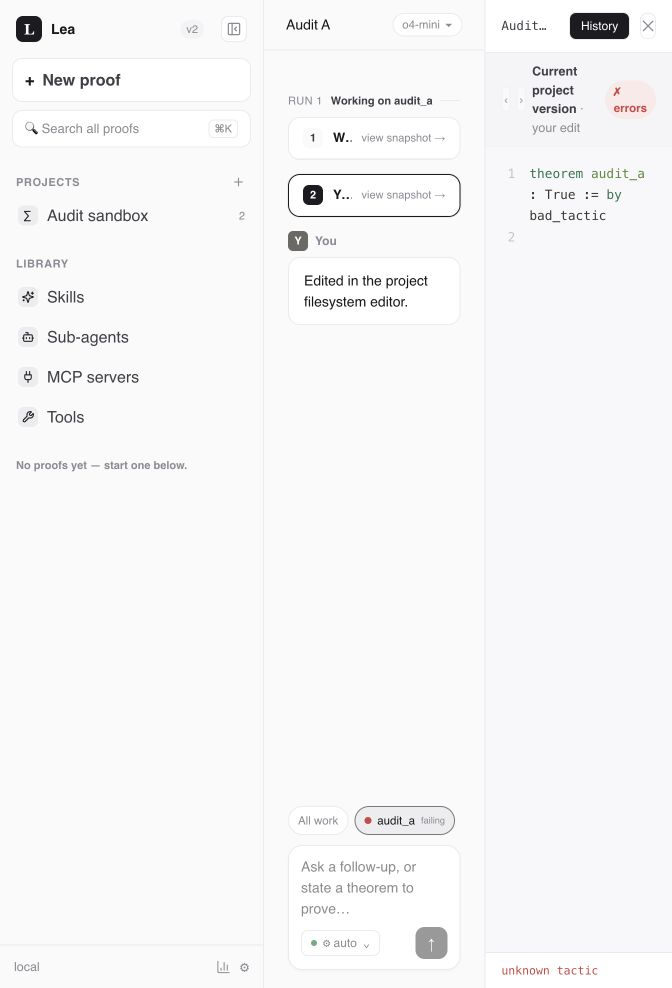

# System bug audit — 2026-10-07

Seven runtime defects were confirmed: four high-priority findings affecting proof
evidence or network boundaries, and three medium-priority findings affecting UI
state, credential redaction, and project deletion. The integration suite also has
outdated fixtures. The subsequent implementation fixed all seven findings and repaired those fixtures; the original findings below describe the pre-fix baseline.


## Implementation status

All seven runtime fixes are implemented in the working tree, with no schema migration.
Existing user changes were preserved. The shared adapter still drives the prover in-process.

| Finding | Implemented behavior | Regression evidence |
| --- | --- | --- |
| F1 | Manual Lean and SafeVerify results pin canonical step/blob identities and checked bytes; stale evidence returns 409. | `test_audit_proof_integrity.py`: delayed success/error/cascade checks, coalesced rows, cross-session edits, missing hashes, SafeVerify race. |
| F2 | Both editors save tracked Lean files through the SQL ledger, materialize atomically, and preserve checked/verified history. | Shared targets, disk repair, failed writes/Git commits, active-project locks, export agreement. |
| F3 | Declarative HTTP tools refuse redirects, retaining authentication only on the configured request. | Actual urllib redirect processing for 301/302/303/307/308, private/public/relative destinations; useful direct responses. |
| F4 | Companion Host validation runs before CORS, preflight, or routing. | Attacker Host cannot dispatch export; local Host and Overleaf/extension Origins remain accepted. |
| F5 | Navigation generations, request cancellation, scope ownership, and stream identity reject obsolete async updates. | Real hook and App callbacks: reconciliation, reconnect, resync, late SSE, A→B→A, save/check/verify; API conflict messages. |
| F6 | Classifier failures expose an error type; common redaction covers persistence, live completion, replay, and read models. | Dummy provider keys absent from live SSE, raw stored rows, API reads, and terminal replay. |
| F7 | Exclusive deletion rejects pending/running work and worker leases through final cleanup; deleted identities stay closed. | Pending/running deletion, operation races, terminal cleanup leases, late mutation. |

The initial targeted regression suites failed against the old behavior: 12 proof cases,
6 boundary cases, 5 lifecycle cases, and 6 UI ownership cases. Expanded controls pass
with the implementation. The actual compiler already supplied a content hash; F1
closes the remaining gap between its completed result and adapter persistence.

Final validation:

- Adapter: **943 passed**, with unhandled worker-thread warnings treated as errors.
  A final focused bridge/proof rerun after review cleanup: **89 passed**.
- Root `npm test`: **630 companion + 82 frontend tests passed**.
- Cross-layer integration: **8 passed**, including Overleaf manual save/check history.
- Site: **23 passed**. UI typecheck and production build passed.
- **16 affected standalone prover modules passed**; real Lean recovery: **5 passed**.
  Concurrent real Lean checks also passed through the existing prover module.
- `git diff --check` passed. Remaining build-size and dependency deprecation warnings
  are recorded limitations, not newly introduced runtime failures.

The isolated browser smoke used synthetic proofs and a deterministic compiler seam:
a broken Filesystem edit appeared as failing in the canvas, persisted after reload,
and was restored through the session editor API. Its checked bytes matched export.
The separate real Lean suites validate compiler behavior; deferred-response tests
validate switching conversations during an outstanding check.



Existing-data review: **95 of 103 current paths match disk; 8 discrepancies remain for
explicit revision selection**. Both currently proved formalizations were recompiled:
all **8 primary/support snapshots passed real Lean**, without persisting new verdicts.
See [the data review](audit-2026-10-07/existing-data-review.md). No automatic historical
file repair or deployment was performed.


## Scope and method

The baseline was commit `0b330fce9978a8d6eb111e8691b5c564cc323e29`, including the
working tree's pre-existing modifications and untracked project-coordination
module. Findings apply to that working tree, rather than the commit alone.

The review covered the shared FastAPI adapter, vendored prover, React UI, Overleaf
companion and extension, shared model catalog, and setup/launch boundaries.
Attention focused on run admission and completion, proof evidence, persistence,
file mutations, project namespaces, source refresh, network/tool access, and
asynchronous UI updates. Existing tests were run, followed by isolated
reproductions of the findings below. This is a broad audit, not a claim that every
line or possible execution path was verified.

Current source uses SQL content-addressed blobs and timeline entries as the proof
record. Git remains involved in project transport and assets. The older AGENTS.md
description of Git-owned proof bytes does not describe the current implementation;
finding F2 is evaluated against the current SQL-owned design.

Reproductions use temporary repositories and databases, fake provider/compiler
responses where appropriate, and dummy credentials. They do not alter user
projects or make paid model calls. The real Lean tests use a disposable Lake
project. Browser exploitation and a live provider formalization were not exercised.

## Findings

P1 means fix promptly because the defect can invalidate proof evidence or bypass
an intended network boundary. P2 means a reproducible correctness or information
exposure defect with a narrower trigger.

| ID | Priority | Finding |
| --- | --- | --- |
| [F1](#f1-check-results-can-certify-newer-unchecked-bytes) | P1 | A Lean verdict can be attached to bytes written after the check started. |
| [F2](#f2-filesystem-edits-bypass-the-proof-ledger) | P1 | Filesystem edits can leave a broken working proof labeled proved. |
| [F3](#f3-http-tool-redirects-bypass-destination-validation-and-forward-credentials) | P1 | HTTP redirects reach localhost and forward a tool credential. |
| [F4](#f4-the-companion-accepts-non-loopback-hosts-without-an-origin) | P1 | Companion GET requests accept an attacker-controlled Host. |
| [F5](#f5-a-delayed-response-reopens-the-previous-conversation) | P2 | A late API response switches the UI back to an old conversation. |
| [F6](#f6-classifier-errors-can-persist-and-stream-credentials) | P2 | Classifier exception text bypasses credential redaction. |
| [F7](#f7-project-deletion-accepts-an-active-run) | P2 | Project deletion removes an active run's records and working directory. |

### F1: Check results can certify newer, unchecked bytes

**Location:** [routes/sessions.py](../apps/lea-standalone/adapter/app/routes/sessions.py),
lines 450–502, especially the lookup at 457 and update at 502.

`_lean_check_session` checks the disk file, then fetches the latest code step and
applies the verdict to it. It also reads the file for artifact classification and
new timeline entries after the compiler returns. There is no comparison against
the version actually checked. The project mutation guard excludes namespace
migrations; it allows concurrent mutations and does not close this race.

**Reproduction:** A barrier-controlled compiler stub captures a valid file and
waits. The session save route writes invalid replacement bytes while it waits.
Releasing the successful check marks the replacement step `ok`:

```text
checked_good_bytes: True
latest_is_bad: True
latest_verdict: ok
```

**Impact:** An auto-save, another tab, or another conversation editing a shared
file can associate successful evidence with an unchecked revision. The
reproduction establishes the adapter's attribution error; it does not depend on
a Lean compiler defect.

**Recommended fix:** Capture the checked revision and bytes before the operation,
then verify that they still match before recording evidence. Serialize check and
mutation where necessary. Reject or retry stale results instead of back-filling
the latest step. Cover edits during both ordinary checks and cascade checks.

### F2: Filesystem edits bypass the proof ledger

**Location:** [routes/projects.py](../apps/lea-standalone/adapter/app/routes/projects.py),
lines 404–412; [routes/sessions.py](../apps/lea-standalone/adapter/app/routes/sessions.py),
lines 332–341. The UI exposes this route through
[FilesystemTab.tsx](../apps/lea-standalone/src/app/components/FilesystemTab.tsx),
line 373.

The project file route writes and commits a `.lean` file and returns its check
result, but does not add a proof timeline step or invalidate the stored evidence.
The formalization snapshot and validity therefore continue to describe the old
SQL bytes while the shared working directory contains the replacement.

**Reproduction:** Start with a proved theorem, overwrite it through the project
filesystem route, and return a compiler error. The route reports `error`, but the
formalization remains `proved` and its snapshot differs from disk. Saving the
original snapshot through the session route then returns `unchanged: true`
without restoring the disk file:

```text
filesystem_before: proved
filesystem_write: {status: error, detail: bad tactic}
filesystem_after: proved
filesystem_snapshot_matches_disk: False
save_original_snapshot: True; disk_restored: False
```

**Impact:** The filesystem editor and proof canvas can disagree about both content
and verification. Exporting the working directory can include a broken proof
whose formalization still displays successful evidence.

**Recommended fix:** Route Lean file edits through the proof-content persistence
path, attribute them to the affected formalization(s), and invalidate previous
check and SafeVerify evidence. A save considered unchanged must also ensure the
working copy matches the stored bytes. Include filesystem edits of shared files
in regression coverage.

### F3: HTTP tool redirects bypass destination validation and forward credentials

**Location:** [http_tools.py](../apps/lea-standalone/prover/lea/http_tools.py),
lines 119 and 149–153.

`check_url` checks the initial HTTPS/public destination. The default urllib opener
then follows redirects without applying that validation to subsequent URLs.
Its redirect handling also carries the configured Authorization header to the
new destination.

**Reproduction:** The actual urllib redirect handler was used with fake transport
handlers. An accepted `https://public.example/data` response redirected to
`http://127.0.0.1:8001/api/settings`. The local request was issued with
`Authorization: Bearer dummy-secret`, and its response was returned as the tool
result. No real external request or credential was used.

**Impact:** A redirecting tool endpoint bypasses the public HTTPS restriction and
can access local services. A redirect to another external origin can disclose
the tool credential to that origin.

**Recommended fix:** Disable redirects or explicitly validate every destination
before following it. Enforce the scheme/address policy on every hop and remove
sensitive headers when the origin changes. Test public-to-private redirects,
HTTPS-to-HTTP redirects, and cross-origin authentication handling.

### F4: The companion accepts non-loopback hosts without an Origin

**Location:** [companion/server.mjs](../apps/overleaf-extension/companion/server.mjs),
lines 4546–4555.

The companion rejects unrecognized Origin headers only when an Origin is present.
It does not validate Host. Ordinary same-origin GET requests can omit Origin, so
the origin check alone does not enforce the local boundary. The adapter's Host
guard does not protect a request that the companion proxies onward using its own
trusted loopback URL.

**Reproduction:** Dispatch an actual companion GET handler for
`/project-export?overleafProjectId=audit-document` with
`Host: attacker.example:31245` and no Origin. A fake adapter supplies project
bytes. The companion returns status 200 and those bytes.

**Impact:** The server accepts the request shape required for a DNS-rebinding
project-read attack. Exploitation depends on the browser allowing the connection
to loopback under the attacker hostname; a complete browser attack was not run.
The missing server-side boundary and successful export dispatch were verified.

**Recommended fix:** Reject non-loopback Host values before routing requests,
using explicit configured exceptions where needed. Reuse the adapter guard's
semantics. Include originless GET requests to export and other data endpoints in
the companion boundary tests.

### F5: A delayed response reopens the previous conversation

**Location:** [useProofStream.ts](../apps/lea-standalone/src/app/hooks/useProofStream.ts),
lines 219–229 and 263–279; the resync callback at 291 has the same unguarded shape.

`reconcile(A)` awaits session A, then unconditionally calls `applyDetail(A)`. If the
user selects B during the request, the late A response replaces the current
selection, messages, and proof canvas. Reconnect responses also apply old details
without checking that the selection still belongs to that request. Closing a
stream does not cancel a fetch already in flight.

**Reproduction:** Compile the actual hook with lightweight store/API fakes. Start a
deferred reconciliation for A, select B, then resolve A:

```text
selected_after_switch: B
selected_after_old_check_resolves: A
```

**Impact:** Finishing a check or reconnecting an old stream can unexpectedly move
the user into a different conversation and replace the visible editing context.

**Recommended fix:** Give selection changes a generation token or cancellation
signal and check it after every asynchronous fetch before changing UI state.
Apply the same rule to reconnect, resync, and session-load callbacks, including
retry scheduling after stale failures.

### F6: Classifier errors can persist and stream credentials

**Location:** [agent.py](../apps/lea-standalone/prover/lea/agent.py), lines 347–348;
[bridge.py](../apps/lea-standalone/adapter/app/bridge.py), lines 2530, 2593, and 2759.

The result classifier turns a provider exception into raw `result_detail` text.
The normal Finished-event branch passes that detail to SQLite and the done SSE
payload without the redaction used by the bridge's exception handler.

**Reproduction:** A fake provider throws an error containing
`sk-dummy-audit-secret`. The classifier returns that string in its review detail.
Passing the resulting Finished event through the actual bridge leaves the dummy
secret in both the persisted run detail and the done event.

**Impact:** A provider error that echoes a credential can expose it in durable
history and browser responses even though other error paths redact credentials.

**Recommended fix:** Apply the common redaction policy to all public/persisted
result details, including normal completion events and classifier failures. Test
both the database value and emitted SSE payload, rather than only thrown errors.

### F7: Project deletion accepts an active run

**Location:** [routes/projects.py](../apps/lea-standalone/adapter/app/routes/projects.py),
lines 1201–1209; [projects.py](../apps/lea-standalone/adapter/app/projects.py),
lines 768–778.

Deletion checks for an active GitHub import, but not an active prover run. It
removes the repository and cascades run/session rows without stopping or waiting
for workers. The namespace guard does not provide worker lifetime coordination.
The worker's stop callback at `bridge.py:2043–2047` does not treat a missing run
row as a stop request; it still returns the separate stop event's state.

**Reproduction:** Create a project run with status `running`; confirm
`project_has_active_run` is true; call the actual delete route. It succeeds, the
run row disappears, and the repository no longer exists.

**Impact:** An admitted worker loses its persistence records and working files.
Continued model/tool work, failed writes, or orphan files are possible downstream
effects; those effects were not exercised with a live worker in this reproduction.

**Recommended fix:** Reject deletion while runs are active, or cooperatively stop
and drain those runs before deleting. Coordinate deletion with run admission so
a new run cannot enter between the busy check and removal.

## Validation results

| Check | Result |
| --- | --- |
| Overleaf unit suite, via `npm test` | 627 passed. |
| UI frontend suite, via `npm test` | 68 passed. |
| Adapter full pytest suite | 900 passed, 5 DNS-dependent failures, 2 skipped. |
| Adapter custom-tools rerun with network access | All 10 passed, including the five initial failures. |
| UI TypeScript check | Passed. |
| UI production build | Passed; emitted a large-chunk warning. |
| Site tests | 23 passed. |
| Vendored prover standalone non-LSP modules | 36 modules passed. |
| Vendored prover LSP unit modules | 3 modules passed, including 30 recovery unittest cases. |
| Real Lean recovery integration | All 5 passed after allowing the child-process inspection required by `ps`. |
| Companion/adapter end-to-end integration | 2 passed, 4 failed with the checked-in fixture. |
| Diagnostic integration run with only the fake completion corrected in a temporary copy | 4 passed, 2 failed against outdated retry/status expectations. |
| Audit reproduction harnesses | All seven findings reproduced. |

The adapter result represents 905 distinct passing cases across the full run and
the targeted DNS rerun; a single unrestricted full adapter run was not performed.
Initial localhost-binding failures in the Node suites were sandbox restrictions
and disappeared on the permitted rerun. The prover module count is not a claim
that every prover test or opt-in integration was executed.

### Integration test contracts need updating

[tests/integration/adapter_entry.py](../tests/integration/adapter_entry.py),
lines 92–93, emits a successful Finished event without an explicit proved result.
The current bridge conservatively requires that result for a focused target, so
the fake success now becomes `needs_review` and the harness times out waiting for
its older terminal status. Correcting only this fake event in a temporary copy
made two additional tests pass.

The remaining failures in
[formalize.e2e.test.mjs](../tests/integration/formalize.e2e.test.mjs), lines 355–360
and 399, expect retirement/restoration Git commits and a formalized status for
the old source after a failed changed-source retry. Current code keeps working
files for new attempts, labels retirement support legacy-only, and treats the
old proof as stale relative to changed source. These failures identify stale test
expectations; they do not demonstrate a regression in the current retry contract.
The diagnostic copies were kept outside the repository, and the checked-in tests
were not changed.

### Adapter tests leak worker activity across fixture teardown

The full adapter run emitted background-thread exceptions involving a missing
`resume_checkpoint_id` column and a missing `runs` table. Driver threads outlived
their isolated DB fixtures. Treat these warnings as test isolation defects and
join/drain the test workers before restoring the database path. This audit did
not establish a corresponding production migration failure.

## Reproduction files

The saved harnesses archive the pre-fix audit cases. Their original expected
outputs are historical evidence; do not use them as the post-fix validation gate.
The executable regression tests now live in the adapter, frontend, companion, and
prover test suites listed above.

- [Backend, redirect, and redaction reproductions](audit-2026-10-07/backend_repro.py)
- [UI selection reproduction](audit-2026-10-07/ui_repro.mjs)
- [Companion boundary reproduction](audit-2026-10-07/companion_repro.mjs)

## Remaining coverage limits

No paid model run, actual Overleaf/Chrome interaction, GitHub write operation, or
full SafeVerify deployment integration was performed. Local browser verification,
synthetic Overleaf HTTP integration, and real Lean snapshot checks were performed. Tests cover the relevant
seams, but those live workflows remain unverified by this audit.

The dependency advisory scan was not performed. Automatic approval review
rejected `npm audit` because it transmits repository dependency metadata to npm's
external advisory service without specific authorization. Completing that scan
requires approval to send dependency names and versions. No indirect scan was
used to bypass the rejection.
