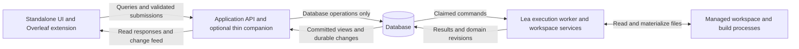
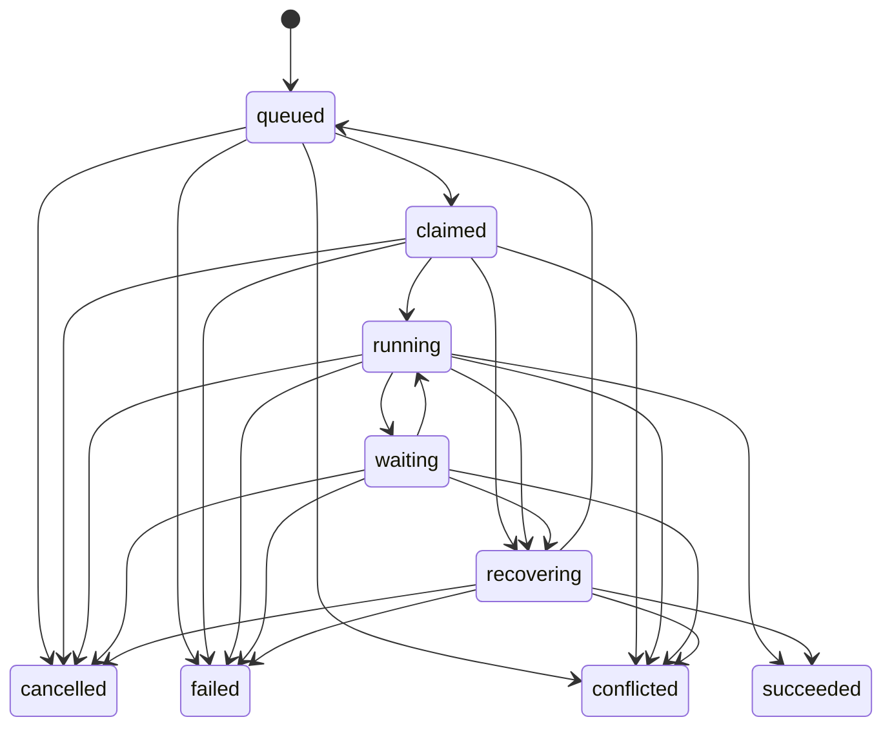

# Feature Specification for Database Mediated Lea Execution

> Status: implementation in progress — 2026-10-17.
> Delivery plan: [PLAN-database-mediated-lea.md](./PLAN-database-mediated-lea.md).
> Scope: standalone UI, Overleaf extension and companion, adapter, Lea runtime,
> workspace services, and persisted application state.

## Purpose and outcome

The UI submits intent and renders persisted application state. Lea executes work
against its managed workspace and records results in the database. Neither Lea
nor its execution bridge can control the browser, change the user's selection,
or supply an alternative live source of application truth.

The only application command path from the UI to execution is a regulated,
durable, one-way queue. Results, requests for human input, progress, artifacts,
and failures are database records that the UI reads independently. Closing every
browser must leave accepted work executable, observable, and recoverable.

This revision establishes ownership and transport contracts. It preserves the
existing proof-preservation, source-faithfulness, human-review, accounting, and
verification guarantees. It does not by itself make an incorrect prover result
correct or authorize broader mathematical changes.

## Current implementation and migration baseline

The following describes the baseline before migration at the specification date.
The [Stage 0 delivery record](./STAGE0-database-boundary-inventory.md) records the
selection fixes and baselines; the [Stage 1 record](./STAGE1-durable-observation.md)
records completed durable observation and retention. The [Stage 2 record](./STAGE2-database-projections.md)
records enrolled database-only core views and observed-input freshness. The
[Stage 3 record](./STAGE3-regulated-commands.md) records the regulated command
framework; the [Stage 4 record](./STAGE4-solver-controls.md) records solver/control
cutover and exact invocation/publication fencing. The
[Stage 5 record](./STAGE5-workspace-commands.md) records workspace commands,
immutable drafts/current bindings and recoverable edit/publication effects.
The [Stage 6 record](./STAGE6-database-ui-cutover.md) records immutable source
publication, database companion ownership and SQL peripheral views. The
[Stage 7 record](./STAGE7-queued-editor.md) covers immutable editor buffers, typed
language requests and SQL results, with direct LSP rejected. Complete process
confinement remains Stage 8. Historical
architecture documents contain older choices that this proposal supersedes.

| Area | Existing foundation | Remaining coupling |
| --- | --- | --- |
| Run admission | [runs.py](../apps/lea-standalone/adapter/app/routes/runs.py) persists submissions and enqueues runs. Idempotency, source checks, spend limits, and model selection already exist. | Queue scheduling and control delivery also depend on process-local structures in [bridge.py](../apps/lea-standalone/adapter/app/bridge.py). Other workspace operations bypass run admission. |
| Observation | Attaching the run events endpoint is already passive and does not start execution. | [runbroker.py](../apps/lea-standalone/adapter/app/runbroker.py) supplies an in-memory event log; the UI applies those events directly. The complete live stream is not a durable database feed. |
| Proof history | [store.py](../apps/lea-standalone/adapter/app/store.py) stores immutable content in `artifact_blobs` and revisions in the timeline. | Some reads inspect disk to derive existence, content, or evidence freshness. Filesystem views expose the working tree through the adapter. |
| Editing and checking | [proof_files.py](../apps/lea-standalone/adapter/app/proof_files.py) has revision guards and durable history. | HTTP handlers can save workspace files or invoke Lean directly; direct LSP WebSocket traffic is another execution path. |
| Presentation | The standalone UI can reload persisted session detail. | [useProofStream.ts](../apps/lea-standalone/src/app/hooks/useProofStream.ts) applies runtime events and can select the formalization Lea is editing. |
| Overleaf | Adapter records already own runs, sessions, formalizations, assessments, and much of source coordination. | [companion/server.mjs](../apps/overleaf-extension/companion/server.mjs) orchestrates work, maintains JSON jobs and associations, reads Lean artifacts, and writes project markdown. |
| Execution ownership | Lea is imported as a library; existing coordination and reformalization services protect important mutations. | [main.py](../apps/lea-standalone/adapter/app/main.py) also starts execution and recovery inside the web process. In-process locks cannot become cross-process coordination unchanged. |

The existing queue and SQL content store are reused. This feature does not create
a competing proof history or retain companion jobs as a second operational ledger.

## Required architectural boundaries



### Meaning of database only UI access

The browser accesses a restricted API, never arbitrary SQL or database files. For
application data, an API request may read database records or commit validated
database mutations. It must not read project files, invoke a compiler, call a
provider, wake a solver, consult the in-memory runner, or contact a workspace
service to complete a read response.

Static application assets, authentication and authorization, credential intake,
database access itself, and transport liveness are infrastructure. They are
explicitly outside the application-data restriction. A liveness response may say
that the API process answers requests; application readiness, worker health,
capabilities, and queue state shown by the UI come from database records.

Overleaf's own editor operations remain browser-local. The extension may read the
active source, observe editor changes, and acquire the project's source archive
using the existing Overleaf integration. Those operations publish source input;
they do not grant Lea browser access. File picking, downloading returned bytes,
local drafts, rendering, focus, and navigation are also UI responsibilities.

This is a complete destination contract. Temporary exceptions during migration
must be named, measured, and removed before strict mode is declared complete.

### Meaning of Lea

Here Lea execution includes the prover plus trusted host services for tools,
checking, dependency publication, project files, imports, exports, and workspace
recovery. Only this worker side may access managed workspace files and build
processes. Deterministic commands such as saving a file do not require an LLM.

The prover retains a typed host interface. The model does not receive arbitrary
SQL, unrestricted database credentials, queue administration, or a browser tool.
The trusted host validates the model's domain updates before committing them.
Configured MCP/custom tools must obey the same boundary: browser automation,
UI-source writes, local API calls used as execution proxies, and direct writes
to command/control tables are unavailable to model-controlled execution.
Provider calls and explicitly configured external tools remain execution
capabilities governed by existing permissions; the diagram describes internal
application ownership, not a prohibition on model-provider networking.

The final deployment separates the web/API process from the worker process. Lea
remains a library imported by the worker. There is no new public prover HTTP
service and no UI-to-worker socket, callback, or HTTP endpoint.

### Meaning of the one way queue

Commands travel from an authorized producer into database storage, then to a
worker. Acknowledging HTTP receipt means durable acceptance, not completion.
Execution never answers through the submitting connection or a runtime broker.
The worker commits results that can be read through ordinary queries or a durable
change feed. A result linked to a command is stored data, not a reverse RPC.

An approval or question is a domain record. The user's answer is another command.
Lea must not instruct the UI to open a modal, switch tabs, alter source text, or
run arbitrary JavaScript. Source publication can continue while work waits.

### Ownership rules

| Owner | Permitted responsibilities | Prohibited responsibilities |
| --- | --- | --- |
| UI and extension | Local interaction state; source capture; explicit submissions; database queries; rendering. | Authoritative job state, compiler execution, workspace access, execution recovery, prompt orchestration. |
| API and thin companion | Authentication, schema validation, scope checks, database queries and transactions, durable change transport, static delivery. | Prover imports, project filesystem access, process-local execution control, derived status based on disk, hidden work on GET. |
| Database services | Command admission, immutable payloads, revision constraints, domain history, query projections, change records. | Storing UI navigation instructions in domain records or using timestamps as a substitute for revision identity. |
| Worker host | Claiming commands; policy revalidation; execution; workspace reconciliation; controlled publication; persisting results. | Browser control, API callbacks, bypassing canonical revision checks. |
| Prover | Scoped reasoning, tools, and validated domain reports through its host. | UI state mutation, direct command authorization, blanket database access. |

## Product behavior

### Work submission and observation

Formalize, re-formalize, continue, chat, batch work, check, verify, repair, and
publication expose the same basic lifecycle: accepted, queued, executing, waiting
when applicable, and a durable outcome. The UI can immediately show that a
submission was accepted, but success requires its persisted result.

Opening another view or disconnecting an event stream does not cancel work.
Every client sees the same run, artifact, usage, assessment, and command result
at the same committed revision. A reload restores partial persisted narration
and active approvals as well as completed messages and proof history.

Queue position is an approximate, derived observation within the relevant
scheduling lane. A blocked project must not prevent unrelated projects from
starting. The UI does not promise a fixed global FIFO start order.

### Stable presentation

Selection of project, conversation, formalization, file, historical revision,
scroll position, editor cursor, and pane layout belongs to the UI. Incoming
records update content without changing those selections. A new artifact can
receive an unread indicator or a user-invoked link.

An explicit follow mode may follow work within the user-selected scope. It is
off by default, clearly controlled by the user, and stops when the user manually
selects another scope or historical revision. A deep link or the user's own
navigation action may select a target; a worker update may not.

### Manual edits

The editor keeps its local draft. Save uploads immutable bytes to the database
and submits `file.save` against an expected file revision. Acceptance does not
replace the published artifact or clear an unsaved newer local draft. The worker
checks the precondition, materializes the edit, and records its outcome.

The UI marks the submitted draft saved only after successful publication for
that draft's identity. A conflicting save retains the user's draft and provides
the current database revision for comparison. There is no last-writer-wins save.
Checking an unpublished editor buffer uses an explicit buffer snapshot and
produces draft diagnostics, never canonical proof certification.

### Overleaf source and multiple tabs

The extension publishes immutable source snapshots on an edit debounce and
before an explicit action. Each snapshot records project/document identity,
target identity, client instance, document sequence, source hashes, capture time,
and source-bundle version. A timestamp alone cannot select authoritative input.

An action binds the exact source snapshot intended by the user. It may atomically
publish that snapshot and submit its command. If required source or dependency
coverage is unavailable, admission returns an actionable database-backed state
or rejects before paid work. A queued action is checked again before execution;
it never silently substitutes a newer source statement.

Independent tabs have independent sequences. Conflicting publications require
an explicit active publisher generation or an unambiguous matching source hash.
An action from another publisher must bind its own snapshot and revalidate the
binding; it cannot overwrite another generation with an incomparable counter.
Unknown source authority is visible and cannot authorize a statement change.

The worker consumes already-published source. It may persist `needs_source` or
`needs_author_input`; the UI renders that state and publishes or answers through
normal inputs. Stage 6 removes the adapter-to-content-script source-refresh
request/response transport; [sourcePublisher.mjs](../apps/overleaf-extension/extension/sourcePublisher.mjs)
publishes editor-owned snapshots through the database API.
Active-buffer and full-project snapshots remain distinguishable; an active file
cannot falsely certify complete dependency coverage.

### Live editor diagnostics and language features

The direct UI-to-LSP WebSocket is incompatible with the destination boundary.
Saved-file checks become queued workspace commands. To retain live language
features, the UI publishes a versioned editor buffer and submits bounded
`editor.analyze`, `editor.complete`, `editor.hover`, or `editor.goals` requests.
The worker owns LSP sessions and persists bounded results by buffer revision,
position, request ID, and environment revision. The UI discards superseded
results and renders only results for its current buffer.

Requests are debounced, coalesced where safe, scoped, deadline-bound, and served
in a separate low-priority lane. Unsatisfied superseded requests are settled as
cancelled; requests already executing can finish with a result the UI ignores.
These records have short retention and cannot certify published proofs. If a
language feature cannot meet the agreed latency budget through this path, it is
explicitly disabled in strict mode until redesigned. Retaining a hidden direct
LSP exception is not an acceptable completion of this feature.

## Command admission and execution contract

### Submission envelope

Use versioned, typed commands. The following illustrates the common envelope;
the server derives authoritative actor and project bindings from authentication
and existing records.

```json
{
  "schema_version": 1,
  "kind": "formalization.reformalize",
  "idempotency_key": "client-generated-unique-key",
  "scope": {
    "project_id": "project-id",
    "session_id": "conversation-id",
    "formalization_id": "formalization-id"
  },
  "expected": {
    "artifact_revision": "revision-token",
    "source_snapshot_id": "source-snapshot-id",
    "namespace_revision": "namespace-token"
  },
  "payload": { "message": "Continue using the revised source." },
  "limits": { "timeout_seconds": 1800 }
}
```

The server assigns command ID, admission order, producer identity, authorization
snapshot, policy version, effective limits, and payload hash. Unknown fields and
unsupported versions are rejected. Client limits may narrow server policy;
they cannot raise privileges or budgets. Chat text is content inside a typed
envelope, never executable queue metadata.

The initial API is `POST /api/commands`, returning HTTP 202 with `command_id`,
`state`, and a query URL after the acceptance transaction commits. An identical
retry returns the same command identity and current receipt without new work;
key reuse with different canonical content returns 409. Validation errors return
422, scope denial 403, and queue/storage exhaustion 429 or 503 with retry advice.
If commit outcome is unknown, retry the same key. Never invent a new key to
compensate for a dropped response.

### Query and receipt interfaces

| Interface | Contract |
| --- | --- |
| `POST /api/commands` | Commit validated acceptance and return a durable receipt. |
| `GET /api/commands/{id}` | Read lifecycle, waiting reason, cancellation request, attempt references, structured error, and domain result references. No execution lookup or wakeup. |
| Existing entity queries | Return database-backed views with entity revisions and a consistent change watermark. Existing paths may be retained. |
| `GET /api/changes` | Read bounded changes after a durable cursor, optionally as an SSE tail. |
| Source/buffer publication | Commit scoped immutable input snapshots, optionally with command acceptance in one transaction. |
| Blob and export download | Stream authorized persisted bytes with size limits; never resolve a workspace path. |

Receipts expose whether work was accepted, what is currently known, and where
to read the outcome. Structured errors include a stable code, readable message,
retry disposition, and relevant current revision. Errors never tell a client to
resubmit uncertain work under a new identity.

### Command families

| Family | Examples | Required treatment |
| --- | --- | --- |
| Solver work | Formalize, re-formalize, chat, continue, repair, batch. | Existing permissions and proof-preservation services; run/attempt lineage and spend accounting. |
| Controls | Cancel run/command/child, resolve approval, answer question. | Separate admission and consumption capacity; exact target and active decision identity. |
| Workspace operations | Save, check, verify, dependency publication, rename namespace, import, export, delete project, Git push. | Worker-owned side effects, revision guards, operation journal where needed. External publication retains existing authorization requirements. |
| Editor work | Analyze, completion, hover, goals. | Exact buffer/environment binding, coalescing, bounded retention, no canonical evidence. |
| Source materialization | Apply a persisted source snapshot to execution context. | Snapshot identity and coverage checks; no browser refresh RPC. |
| Metadata and configuration | Titles, preferences, instructions, model settings, capability assignments. | Pure database-only updates may remain transactional API mutations. Any workspace or runtime effect creates a command in that same transaction. |

The UI can create source snapshots, upload blobs, and change allowed database-only
metadata without starting Lea. None of these operations may cause filesystem I/O
or execution inside a request handler. Agent-created dependency work uses the same
admission/policy service with a worker-derived origin and parent lineage; the model
cannot forge user commands or widen an existing scope.

### Regulation

Admission authenticates the producer, checks project/session/target membership,
validates revisions and command shape, and enforces payload, storage, queue, model,
permission, and cost policies. Host and origin defenses remain mandatory. A
localhost address is not producer identity. Sensitive command metadata and
credentials never enter public change records.

Each accepted command snapshots its effective policy. Execution revalidates
membership, current permissions, source authority, artifact/environment versions,
and resource availability. A revocation takes effect before the next side effect;
retries cannot upgrade their original scope. A user-controlled model choice is
retained unless explicitly unsupported, in which case the command fails visibly.

Normal admissions have finite global, producer, and project queue caps. Controls
have separately reserved bounded capacity and target-level deduplication. A full
compute queue cannot prevent Stop or a decision for an existing active approval.
No unbounded command type, shell snippet command, or arbitrary tool invocation
endpoint is introduced.

Initial tunable defaults below are calibrated against the synthetic history and
runtime fixtures in the [Stage 0 baseline record](./database-migration-baselines/README.md).
They bound initial admissions; paid solver throughput and full published-image
capacity require later release qualification. Changes
to these limits cannot relax authorization, revision, or publication rules.

| Limit | Initial default |
| --- | --- |
| Command envelope | 64 KiB; larger source/file content uses scoped blob references. |
| Queued compute commands | 128 globally, 32 per producer, 16 per project; batch fanout also consumes bounded capacity. |
| Reserved queued controls | 64 globally, with one pending cancellation per target and one pending decision per approval identity. |
| Queued editor requests | 8 per producer; retain only the newest equivalent pending request per buffer/request kind. |
| Editor request deadline | 5 seconds; expiration settles visibly without canonical effects. |
| Text chunk | At most 16 KiB UTF-8 per persisted chunk, normally committed every 200 ms (boundary flushes may occur sooner). |
| Change query page | 200 records by default, maximum 1,000 and 1 MiB metadata payload. |
| Source files / source bundles | 4 MiB per file / 32 MiB aggregate per bundle. |
| Attachments / exports | 25 MiB per attachment / 64 MiB aggregate per export. |
| Worker claim heartbeat and lease | Heartbeat every 5 seconds; lease 30 seconds. Expiry starts recovery and never proves a process has stopped. |
| Short lived results | Editor results 1 hour; export results 24 hours unless pinned or actively referenced. |
| Change replay window | 7 days initially; older clients reload a snapshot. Proof history is unaffected. |

Blob/upload/export byte caps are fixed per supported artifact class above;
admission is not enabled for an unbounded class. Compact idempotency receipts
outlive result-payload retention and are not deleted while their key could be
retried. An expired result returns an explicit expired reference, not a new run.

The original effective deadline and cumulative cost survive retries and recovery.
Spend is rechecked before paid invocations against the shared accounting ledger;
the existing cooperative cap can still overshoot by an in-flight provider request.
Uncertain usage stays uncertain until reconciled and is never rewritten as zero
to permit another attempt. These limits do not create a new permission tier.

### Durable lifecycle and scheduling

Persist command lifecycle separately from solver-run status:



`waiting` records an explicit reason and required input. `recovering` suppresses
unearned success and automatic replay of uncertain effects. `succeeded` means the
command contract completed: a check command may succeed operationally while its
recorded Lean verdict is an error. A solver run may retain a proved, disproved,
paused, incomplete, or other existing domain outcome independently of this state.
Recovery can settle success only from an already-proven committed effect or a
completed publication journal. A changed source that requires a new statement
needs a newly bound continuation command; waiting work cannot silently rebase.

Claims use conditional updates in short `BEGIN IMMEDIATE` transactions. Persist
worker identity, epoch, claim generation, lease expiry, heartbeat, and attempts.
Side effects never run while holding a SQLite transaction. Claims, outcomes, and
projection updates check the current ownership token.

Delivery is at least once. Exactly-once model calls, shell effects, or Git pushes
are not promised. Repeated delivery uses recorded invocation and application
identities; uncertain paid or externally published work is reconciled or exposed
for explicit continuation rather than blindly replayed.

Use compute, control, and editor scheduling lanes over the same durable command
model. Order conflicting workspace mutations within a project, preserve existing
reformalization reservations and dependency handoff, and allow independent
projects to progress. Cancellation and approval consumption must run independently
of blocked solver threads and project execution reservations. Waiting for an
approval must not hold a database transaction or the lock required to resolve it.

The first release supports one execution worker process with bounded internal
concurrency and a fast control consumer. Process-local events and LSP queues may
exist inside that worker as optimizations after it consumes database commands;
the API never accesses them. Multiple worker processes are deferred until every
project reservation and filesystem fence has a cross-process implementation.

### Stop and approval races

Cancel and approval decisions are themselves commands. The API commits the intent
without reaching into `_stop_events` or `_pending_approvals`. The control consumer
then signals the executing task and commits the decision and observed outcome.

Persist pending approval identity, tool invocation, permitted decision values,
policy, expiration, and resolution. A duplicate matching decision is idempotent;
a different decision after settlement conflicts. A cancellation already accepted
for a target takes precedence over later approval acceptance. The decision gate
also rechecks durable cancellation immediately before releasing a tool.

Cancel-before-start and claim must have one transactional winner. When work has
already begun, the UI distinguishes requested cancellation from observed stop.
Completed side effects stay recorded. Cooperative cancellation cannot promise
that an already-started shell command or provider call never happened.

## Database records and observation

### Storage design

Extend existing tables where their meaning fits. The following logical records
define responsibilities, not a requirement to duplicate existing run, attempt,
usage, formalization, review, dependency, or content tables.

| Record | Required information |
| --- | --- |
| Commands | Typed immutable envelope, producer and scope, idempotency key/hash, admission order, policy/limits, expected revisions, lifecycle, ownership/lease, outcome references. |
| Command attempts | Claim generation, worker epoch, execution/checkpoint identity, invocation accounting, recovery disposition. Reuse existing run attempts for solver details. |
| Source and editor snapshots | Immutable bytes or blob references, authority generation, sequence, hashes, capture metadata, source coverage, document/buffer version. |
| Current file bindings | Project/path identity, current blob/revision, tombstone, file role, publication provenance, materialization state. History continues in existing immutable storage. |
| Workspace observations | Observed revision, environment/dependency identities, reconciliation state, worker epoch, last successful scan, invalidation reason. |
| Domain changes | Durable monotonic change ID, transaction/batch identity, entity revision, scope, change kind, optional bounded payload. |
| Runtime observations | Worker heartbeat/epoch, lifecycle, capabilities and supported versions, freshness interval, drain state. |
| Approvals and questions | Durable request and resolution, exact run/invocation/revision bindings, expiry and policy. |
| Operation results | Editor diagnostics, export bytes, external operation receipts, structured errors, and links to existing domain results. |

Indexes and constraints must enforce producer/key uniqueness, valid claim ownership,
stable file identities, and unambiguous revision binding. Persist deletion
tombstones and referenced results long enough for reconnecting clients and command
deduplication. Retention cannot remove proof history, unresolved approvals,
active command payloads, recovery before-images, or the only record of an effect.

### Changes and consistent reads

All authoritative domain mutations append a change record in the same database
transaction. No domain update may depend on a later best-effort notification.
The change log can carry invalidations; it need not duplicate large content blobs.

Queries return entity revisions and a durable change watermark from one SQLite
read transaction. A client loads a snapshot, then subscribes after that watermark.
The feed uses database change IDs as cursors, supports replay, and tolerates
duplicates. If retention has removed a cursor, the server requires a fresh
snapshot rather than silently omitting changes.

API and companion SSE connections tail the database change log. In-memory wakeups
may reduce latency but cannot supply missing data. Slow consumers receive bounded
pages or reconnect instructions; they cannot stall execution or grow an unbounded
per-client buffer. Authorization filtering occurs before results are returned.
Filtered cursors advance across inspected changes without revealing other scopes.

Clients use revision-aware upserts and tombstones. An older HTTP response cannot
overwrite a newer streamed revision. Related multi-entity changes are applied as
a complete committed batch or cause a coherent query refresh. Client wall clocks
and existing message `seq` values are not change-log cursors.

### Persisted streaming text

Batch generated text into bounded database updates, each with message identity,
attempt identity, and monotonic chunk sequence. Persist before announcing. The
in-progress message is queryable and survives reload. Completion or interruption
finalizes that same identity; the UI does not guess which final message replaces
a temporary bubble by comparing string contents.

Store compacted message content plus bounded recent chunks as appropriate. Only
committed chunks are guaranteed after a crash; the display never shows bytes
that have not been committed. Tokens generated but lost before commit do not
justify automatically repeating a paid invocation.

## Workspace publication and freshness

### Canonical state and files

The database is canonical for application-visible content, artifact identity,
history, and publication state. Files are the worker's execution materialization.
A successful compilation is evidence about exact bytes and environment inputs,
not a guarantee inferred from a filename or a successful command alone.

Use current proof blobs and timeline history. Add a current binding for supported
non-proof files, instructions, memory, blueprint inputs, uploads, and source
material. Model catalogs, library/graph inventories, configuration status, and
export results also need database-backed views. Git remains provenance and
interoperability storage; UI reads do not execute Git.

Database and filesystem commits are not atomic together. Reuse and extend the
existing [reformalization application journal](../apps/lea-standalone/adapter/app/reformalization_apply.py)
for recoverable publication instead of claiming that a SQLite transaction can
roll back disk writes. Each workspace-changing operation must:

1. Retain immutable candidate bytes, baseline revisions, and necessary before-images.
2. Acquire the appropriate worker-side project/application reservation and verify
   its ownership, revision preconditions, source policy, and exact edit scope.
3. Commit publication intent and invalidate affected current evidence before
   replacing canonical files. Queries show an application in progress.
4. Install the intended bytes safely, run required canonical checks, and retain
   their exact input/environment identities. Do not hold a database transaction
   while compiling or moving files.
5. Atomically publish database bindings, validity/evidence, dependent impact,
   operation outcome, and change records after successful canonical application.
6. Reconcile an interrupted application from its journal before advertising
   readiness. Preserve baseline, candidate, and observed conflicting versions.

An admitted edit can exist as a durable draft before publication. An installed
file with unfinished publication cannot be exposed as newly verified canonical
content. Failure may retain drafts, restore a prior version through the journal,
or expose a conflict; it cannot delete the only surviving work.

### Current evidence without filesystem reads

Move disk inspection, compiler-derived inventory, dependency discovery, and
freshness reconciliation to the worker. Persist observed file, source, environment,
and dependency revisions with check evidence. Database queries derive status by
joining those revisions and applying shared pure projection functions.

Observed mutations invalidate affected evidence before the UI can treat a new
revision as checked. Preserve historical passing results with their original
inputs. Worker heartbeat expiration, incomplete reconciliation, an applying
journal, or environment uncertainty produces a visible stale/unknown state from
database timestamps and records; a GET never repairs it by probing disk.

A managed workspace has one authorized writer side. External editing is an import
boundary: watchers trigger reconciliation, and a periodic scan covers missed
events. Observed external bytes become immutable database revisions with external
provenance, invalidate affected checks, and can conflict with pending operations.
The worker compares actual files again before application and execution.

Database-only reads cannot detect an arbitrary unobserved external write
instantaneously. UI validity means valid for the recorded observed revision and
environment, with its reconciliation state shown. It must not claim fresh proof
truth about every uncontrolled disk mutation. Retain the external-write limits
in [FEATURE-shared-file-reformalization.md](./FEATURE-shared-file-reformalization.md).

### Preserved mathematical guarantees

Keep stable formalization IDs, exact selected declarations, source bindings,
draft versus canonical applicability, checked helper publication, immutable
before-images, and revision-bound human review. A file containing multiple
declarations remains supported. Commands cannot bypass target-preservation or
shared-dependency ownership by presenting a newer timestamp.

Pure status projection code may be shared between processes. It must not call
`Path`, LSP, a provider, or a workspace snapshot service during a UI query. New
materialized projections carry their input revisions and are rebuildable from
durable records; they are never an independently editable validity flag.

## Configuration and peripheral operations

Store non-secret application settings and assignments in the database. Import
existing TOML settings once with an explicit migration record. Any supported
future config-file import becomes a worker command; it cannot compete silently
with the Settings UI as a second authority.

Credentials use a dedicated intake boundary that returns a secret reference and
redacted status. Persist only references and presence/validation state in public
application records; never place raw credentials in command envelopes, change
feeds, logs, or model-visible history. The worker's trusted credential service
resolves references when needed. Bootstrap secrets and credential storage are
infrastructure exceptions, not general project filesystem access for the API.

Uploads commit bounded database blobs and metadata before acceptance. Imports,
Git operations, catalog refreshes, and exports run on the worker. An export
publishes a bounded database-backed artifact or chunked content record for API
download; a download handler does not open a workspace ZIP. Large files require
streaming and storage caps without introducing an unrestricted filesystem URL.
Blueprints and dependency graphs use persisted source/compiler inventory.

Deleting a project first tombstones it and prevents new admission. A command
settles active work and performs managed cleanup. Referenced evidence, command
receipts, and recoverable content follow explicit retention policy. Namespace
changes preserve current project identity and invalidate old revision tokens.

## Reliability and operational limits

The first target remains local SQLite with WAL and short serialized write
transactions. Do not introduce Redis, a distributed broker, or a new database
engine as a prerequisite. Connection loss has no authority over accepted work.
If the database cannot commit, admission fails and the worker pauses before new
effects or further paid calls; output must not bypass persistence to look live.

A worker lease alone cannot stop a surviving old shell from writing files.
Recovery must establish exclusive workspace ownership, reap or fence previous
owned processes, reconcile pending publications, then admit replacement work.
Persist worker epochs and reject stale database writers as well. An unprovable
old execution state becomes recovery-required, not an automatic second execution.

Drain stops new compute claims while keeping queries, source publication, controls,
and recovery available. API restart does not restart Lea. Worker restart restores
eligible checkpoints and approvals according to their existing policy; uncertain
provider invocations and external effects remain explicit.

Initial performance targets are validation gates, measured on a recorded supported
local environment with representative projects:

| Measure | Target |
| --- | --- |
| Valid small command acceptance | p95 below 250 ms while representative proof work runs. |
| Committed progress to visible UI | p95 below 500 ms; text commit batches normally 100–250 ms. |
| Accepted cancellation consumed by worker | p95 below 500 ms, excluding the current tool's cooperative stopping delay. |
| Saved snapshot or pending approval after reload | Reconstructed in the initial query without a live runner lookup. |
| Live editor diagnostics | p95 below 1 second after debounce for a warm small-file case; expose a capability limit when unavailable. |
| Normal database read | Zero project filesystem, compiler, provider, or execution-control calls. |

Set finite limits for command payloads, upload/export bytes, text chunks, change
pages, per-producer backlog, editor requests, and retention before enabling each
feature. Measure DB write contention, WAL growth, queue wait, control latency,
replay lag, reconciliation lag, stale claims, and duplicate invocation avoidance.

## Acceptance criteria

| ID | Required evidence |
| --- | --- |
| A01 | With project filesystem access denied to the API, all supported application views and downloads work from database records. Unindexed data is explicitly unavailable. |
| A02 | The API can start and serve application queries without importing the prover, starting LSP, or owning a workspace. Its reads cannot launch execution or recovery. |
| A03 | Accepted commands survive HTTP response loss and both API and worker restarts. The same producer/key creates one logical command and operation lineage; known completed effects are not replayed and uncertain effects require reconciliation. |
| A04 | Closing all clients, restarting the companion, or dropping every SSE connection leaves accepted work running and its results inspectable. |
| A05 | A snapshot plus changes after its watermark reconstructs the same scoped application state as a fresh query, including partial text, tombstones, approvals, and terminal outcomes. |
| A06 | Incoming changes cannot change user-selected conversation, target, file, historical revision, cursor, or layout with follow mode off. |
| A07 | Cancel-before-claim, cancel-during-tool, approval-after-cancel, duplicate decisions, full compute queues, and waiting parents settle without control deadlock or fabricated success. |
| A08 | Concurrent saves and source publications preserve exact revision and publisher bindings. Conflict retains local drafts and all durable before-images. |
| A09 | Process death at every publication boundary recovers the existing baseline, intended result, or explicit conflict without losing history or certifying uncommitted work. |
| A10 | Status reads perform no filesystem freshness checks. Worker-observed changes and environment updates invalidate current evidence; offline reconciliation is visibly stale/unknown. |
| A11 | Overleaf JSON jobs, generated target mappings, batch state, and chat associations are migrated without inventing proof evidence; the final companion has no authoritative job store or workspace access. |
| A12 | Source acquisition uses published snapshots. No adapter/worker request calls back into an Overleaf tab, and ambiguous multiple-tab input cannot authorize paid work. |
| A13 | Strict mode has no direct LSP channel. Supported language features use versioned persisted requests/results, and stale diagnostics never replace current-buffer diagnostics. |
| A14 | Existing shared-file preservation, disproof selection, source-faithfulness, permissions, reviews, helper ownership, usage, and spend-cap tests continue to pass. |
| A15 | Old clients cannot invoke bypass endpoints after strict cutover. Compatibility routes either commit equivalent commands or reject before side effects with an upgrade response. |
| A16 | A worker crash leaves the API readable. Stale workers cannot publish outcomes or overlap managed workspace writers after takeover. |
| A17 | Settings, project files, source mirrors, catalog views, imports, exports, graph/blueprint views, and project lifecycle operations obey the same boundary. Credentials follow the explicit intake exception. |
| A18 | Each migration stage has a tested rollback that preserves new history and accepted commands. No stage runs old and new side-effecting executors for the same operation. |

## Delivery constraints and deferred work

Ship incrementally using the linked plan. Compatibility is permitted through
adapters that translate requests into the new contract; silent fallback to a
workspace read or direct runner call is forbidden in strict mode. Read comparisons
and shadow projections are safe; shadow execution of paid or mutating work is not.

Distributed workers, semantic merging of conflicting proofs, a general event
sourcing rewrite, remote database access from the browser, and unrestricted
agent SQL are outside this revision. Existing domain tables remain the business
record; the durable change log serves observation and the command table serves
execution admission. Neither replaces immutable proof history.
