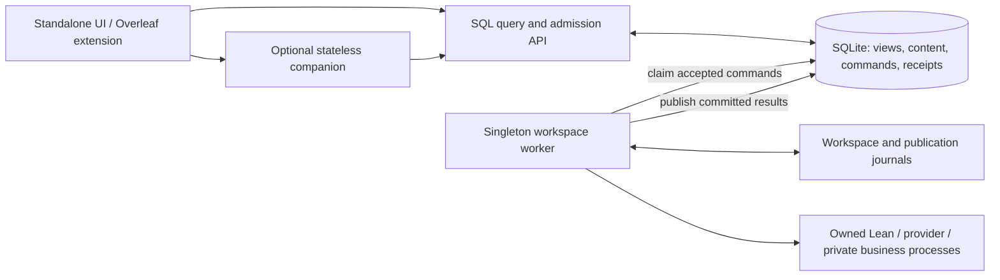

# Stage 8 — separate API and workspace worker

Implemented 2026-10-17. This record supersedes the historical web-process runtime
and Git-only content descriptions. The governing contract remains
[FEATURE-database-mediated-lea.md](FEATURE-database-mediated-lea.md).

## Runtime and authority



`run_api.py` serves HTTP, SSE, static assets and infrastructure credential intake.
It starts no workers, performs no recovery or migrations, acquires no worker lock,
and does not import the prover. Application queries, downloads, saved source,
editor results and admission decisions use SQL. Its shutdown only closes HTTP
connections. Observer disconnection does not stop accepted work.

`run_worker.py` owns the physical workspace, command consumers, run scheduler,
publication recovery, dependency services, catalogs, provider calls and compiler
children. `app/worker.py` contains the former web startup/recovery sequence. The
private Node business process remains a child of this worker. Its authenticated
HTTP calls access the same SQL query/admission service, with a recorded parent
command and database-verified epoch proof. They cannot invoke execution in the API
or send navigation/selection instructions to a client.

Public routes live in `app/api_routes/`. They contain SQL queries, typed request
contracts and queue intake. Execution handlers remain private in `app/routes/`,
registered only in the worker. Contract tests compare the route set and request
schemas. `workspace_commands._contracts` contains public validation contracts;
`_actions` contains executors and must be empty in an API process. Shared SQL
policy, project identity, checkpoints, reports and reformalization admission no
longer import their execution services. Continuation admission retains SQL inputs;
the worker repeats workspace freshness checks before dispatch.

The old in-memory session notification counter is replaced by the durable change
watermark. `RunBroker` is a worker-local SQL publisher/test sink, inaccessible to
the API. Public observation reads the durable cursor directly. There is no legacy
web dispatcher, API-to-bridge signal, source callback or direct LSP fallback.
Admission-disable switches remain emergency stops; none enables a bypass.

## Ownership, fencing and health

Bootstrap and worker retain `.lea-adapter.lock` beside the DB, including its old
name so an earlier live owner prevents a transition. Alembic separately serializes
migration planning and backups using its migration lock. The API takes neither
lock. The worker additionally holds `.lea-worker.lock` in the resolved physical
workspace for local development. Containers use the shared Docker local
`lea-workspace-ownership` volume at `.lea-runtime` instead of their private image
root. Both migration and worker take that ownership lock. Startup verifies that
the filesystem enforces exclusive locks; virtualized bind mounts that silently
ignore them are rejected. A version-2 `.lea-workspace.json` binding beside the DB
pins the root and persistent ownership-volume identity. Root/volume relocation
requires an offline migration. See the [production ownership contract](STAGE8-release-qualification.md).

Before recording a new lifetime or recovering journals, the worker verifies and
reaps the old data-directory child manifests and the new workspace-owned manifests.
A child must still hold its inherited ownership lease before its process group
can be signalled. Unverifiable ownership fails closed, including a held lease left
between child spawn and receipt registration. SQL lease expiry never
permits overlap with a live workspace owner. Locks remain held until process
exit/exec, including while daemon threads finish.

Migration `0048_process_boundary` adds the singleton worker publication: runtime
identity, monotonically increasing generation, PID, lifecycle state, timestamps,
non-secret capabilities, operational snapshot and hashed private bridge proof.
The worker publishes each second with a 15-second observation lifetime. The API
never probes its PID, workspace or compiler. Expiry reports `worker_unavailable`;
a mismatched advertised boundary reports `worker_incompatible` and closes new
execution admission. Control intents retain their independent queue lane.

`/api/health` reports HTTP availability plus SQL worker state. `/api/ready` returns
503 until the worker is ready. During recovery, drain or an expired heartbeat,
ordinary database views remain available. Restart/shutdown requests are queued
worker controls; they do not restart or terminate the API. A control records its
target runtime identity; replay cannot restart a replacement lifetime. The
supervisor restarts a crashed role independently; a clean stop or repeated crash
loop leaves the other roles running. Pending commands and idempotent receipts
survive both processes. Workers reject an unsupported queued command version
before execution.

## Enforced API boundary

Every API entry installs `api_boundary.py` before loading routes. It rejects
preloaded/private execution modules, prover/provider imports, executor/observer
registration, workspace/config reads, child processes, outgoing connections and
DNS resolution. Allowed filesystem access is the database/journal directory,
explicit HTTP/credential intake scratch, static assets, code/runtime libraries and
system MIME data. It removes inherited provider credentials. API tests run this
boundary in fresh processes, rather than treating embedded test seams as isolation.

The local audit guard prevents accidental architectural violations; it is not a
sandbox against injected malicious Python. Container isolation adds a read-only
API filesystem with the workspace, compiler, configuration and worker Node trees
absent. Compose mounts only the DB directory into the API, drops capabilities and
uses `no-new-privileges`. Only the worker and the privileged one-shot migration job
mount config, proofs, project metadata, legacy import input and the Mathlib build
volume, plus their shared ownership volume. Bootstrap can
therefore recover historical Git-backed content before either serving process
starts; the HTTP API never receives these mounts. The transport has no state or
workspace mount. Credential tickets remain the explicitly allowed infrastructure
exception, never command payloads or SQL secret blobs.

Standalone startup and the stateless companion negotiate boundary v1, including
query, change, command, source-publication and queued-editor versions. Missing or
incompatible services are rejected; they cannot activate an older transport.
Worker contracts are checked separately from HTTP availability. Legacy endpoints
remain typed SQL translators or explicit rejections, inventoried by the boundary
audit. Reads never trigger scans or recovery.

## Launch and upgrade

Local `npm run start:adapter`, `npm run dev -w apps/lea-standalone` and the shared
supervisor first run `adapter/bootstrap.py`, then independently supervise API and
worker. `LEA_CONFIG_FILE` selects a worker infrastructure config;
`LEA_SHARED_DATA_DIR` selects shared storage. `LEA_DATABASE_FILE` can explicitly
select a database filename. Custom denied paths can be supplied with
`LEA_API_DENY_PATHS`. API and worker must use the same prepared database.

For manual development, after stopping existing owners:

```sh
cd apps/lea-standalone/adapter
.venv/bin/python bootstrap.py
# In separate terminals, with the same data-directory configuration:
.venv/bin/python run_worker.py
.venv/bin/python run_api.py
```

Neither serving entrypoint migrates. An unprepared/incompatible schema refuses
startup. Bootstrap preserves existing data/backups and refuses to migrate beneath
a live workspace worker. Do not migrate while an old API is serving requests.

Compose has four services: a one-shot migration job, API (`lea`), worker, and
optional stateless companion. The Dockerfile provides `api`, `worker` and
`companion` targets. The explicitly dispatched publication workflow qualifies each
role on both native architectures and pushes the saved, tested binaries without
rebuilding. Matching role images must be published before using
the hosted Stage 8 Compose configuration. No image was pushed by this migration.
Pin a matching immutable bundle when qualifying a release.

Keep all existing host directories and named volumes. Stop the old stack, retain
its backup, run migration, then start the matching pair/transport. Never use
`down -v`, reset-local-state, or volume recreation as an upgrade mechanism.

## Qualification and release limits

### Worker stability and check overhead follow-up (2026-10-18)

The [failed Formalize All assessment](database-migration-baselines/overleaf-formalize-all-2026-10-17.json)
established multiple worker lifetimes, expired solver ownership, excessive
preparation/search time and a false turn-cap explanation. It did not establish
the original process-exit trigger: the old terminal-only output was unavailable.
The [follow-up qualification](database-migration-baselines/worker-stability-check-overhead-macos-arm64.json)
records the reproduced failure paths and before/after measurements.

Transient SQLite BUSY/LOCKED failures in worker status publication no longer
terminate the process. Cancellation/ownership polling pauses at the stop gate,
retries only contention for a bounded interval, and rechecks current ownership
before allowing execution. A prolonged outage stops execution; it cannot authorize
another effect from stale state. Non-contention failures and obsolete process
publication remain fatal. Execution claims and their worker lease renew in one
transaction, without reviving an expired lease; loss of the worker lease initiates
restart/reconciliation. Cleanup runs even if final status publication fails.

The supervisor and worker now retain bounded diagnostics beside the database in
`worker-diagnostics/`: supervisor lifecycle/exit code/signal events, worker stderr,
redacted Python logs and lifecycle events, and four native-fault logs. Log files
are owner-only, with two rotated backups for each rotating stream. The worker
publishes a bounded recent-event summary in its existing SQL health snapshot.
The API cannot import the diagnostics module or open that directory. Native-fault
output is private; the API never reads it. Supervisor changes require a full
`start-dev.sh` restart to activate.

Library discovery no longer compiles candidates by default. Unverified entries
retain `reusable=false`; explicit dependency validation and the consumer check
still certify reuse. Dependency resolution is cached by the complete import
header and configuration rather than proof body. Preparation reuses overlapping
manifest observations with final identity checks and transfers its exclusive
build lease into a shared compiler lease without a mutation gap. Compiler,
source, configuration, dependency, sidecar and result-selection guards remain.
The disposable quadratic profile measured corrected checks at 14.95 → 9.08 s,
unchanged warm checks at 3.90 → 2.27 s, and preparation after a proof-only edit
at 3.91 → 1.02 s. First-time dependency discovery and selected-result inspection
remain material costs; these measurements are not production latency guarantees.

Interrupted companion results preserve explicit stop reasons, timeout/spend/turn
caps and recovery-review details. An unspecified interruption cannot become a
turn cap or a user stop. Accepted/completed report bookkeeping is persisted, and
background bookkeeping failures are observed instead of causing an unhandled
promise rejection. Historical run/report facts have not been rewritten and no
paid formalization was replayed. Existing checkpoint compatibility checks remain:
changed executable/tool contracts require a fresh Re-formalize attempt.

### Import advice, dependency admission and observer load (2026-10-18)

The [next run assessment](database-migration-baselines/overleaf-formalize-all-2026-10-18.json)
found a stable worker, but a passing proof spent the remainder of its deadline
in mandatory import analysis. A separate target rejected a completed dependency
while its SQL proof projection was still being refreshed. The
[qualification record](database-migration-baselines/import-analysis-projection-live-load-macos-arm64.json)
contains the regressions, native profiles and development activation evidence.

Import analysis is optional, with a 10 second check budget and at most one
attempt per saved execution, including continuations. It adds only the targeted
min-imports linter to a disposable copy and uses a separate compiler process.
Timeout or failed advice leaves the original proof and its check evidence intact
and instructs the solver to finish without retrying. Advice cannot replace proof
evidence, and any actual import edit still requires a successful current check.
The native timeout returned after 10.05 seconds; a subsequent proof check passed
on the same shared Lean daemon generation. Existing checkpoint compatibility
checks remain strict; old paused attempts require a fresh Re-formalize.

Dependency admission reads one SQL target-status snapshot for all requested
dependencies and target kinds on each poll. An unfinished or changed projection
waits for a fresh observation; an observed missing, stale or incompatible
dependency remains a rejection. Permanent access errors fail immediately.
The worker polls every 500 ms for a 30 second slice, subject to bounded metadata
requests. Formalize All persists the pre-admission wait, retains pending items
without skipping descendants, and resumes through the existing five second
reconciler. Cancellation and worker epoch fencing remain authoritative. A worker
restart can safely recover this wait because no solver run has been admitted.
These reads use the existing SQL query path and never initiate workspace access,
compilation or a worker refresh from a GET.

The stop gate now reads only cancellation, deadline and current command ownership
in one short SQL snapshot. Manifest traversal starts its next polling interval
after the preceding SQL read returns, preventing a slow read from retriggering
for nearly every dependency file. No cancellation or ownership decision is
cached. Check telemetry records cancellation time and poll count separately.
A deterministic regression with 1,000 sidecars and 75 ms metadata reads now
finishes below five simulated seconds instead of exhausting its check budget.
With real workspace/core observers and SQL ownership reads, the native fixture
measured proof edits at 3.74 → 2.62 seconds and warm checks at 3.89 → 2.94 seconds.
Cold checks remained 26.86 seconds, including about 15 seconds of dependency
discovery. The historical 202.7 second check was not fully reproduced; these
measurements establish the corrected polling behavior and fixture performance.

Qualification passed the complete 842-test Overleaf suite plus two later
access/fencing cases, 124 evidence/projection/checkpoint/recovery tests, the final
four import-advice tests, and 41 process/stability/solver tests. One native editor
test retained its explicit opt-in skip. The boundary register still covers 179
adapter routes and 27 companion dispatch branches. No schema or public route
was added. The idle development worker loaded the changes through the existing
queued `runtime.control` restart, reached ready at generation 2, and retained
identical run, attempt, checkpoint, proof-evidence, artifact-blob and batch-report
digests. No paid formalization was replayed. Production images were not rebuilt.

Development-cutover results are in
[stage8-qualification.json](database-migration-baselines/stage8-qualification.json)
and [stage8-container.json](database-migration-baselines/stage8-container.json).

### Completion inventory synchronization follow-up (2026-10-18)

The [completion assessment and qualification](database-migration-baselines/overleaf-completion-status-synchronization.json)
records a successful nine-target batch: seven proofs, two definitions and a ready
report. An optional inventory target-sync request encountered `project_busy`
immediately after completion. The exact user-visible banner wording was not
retained; the saved request establishes a metadata conflict, rather than a failed
proof or a SQLite BUSY exception during this batch.

The subsequent inventories returned unknown proof status while the SQL projection
was `inputs_changed`. The companion discarded that projection metadata, mapped
unknown checks to compiler errors, and counted unknown items as unformalized in
file progress. All nine became correctly checked once the new projection arrived.
The companion now preserves projection metadata and exposes synchronizing checks.
Unknown checks remain unconfirmed, and collapsed file progress uses an explicit
Awaiting status bucket. Pending observations and deferred target synchronization
keep the existing five second inventory polling loop alive after solver activity
ends. Transient busy/transport failures in optional target synchronization produce
a neutral pending notice and retry through that loop; permanent access rejection
still produces an error. Pending items cannot be submitted again from the pane.

All 853 extension tests passed. An isolated Chromium fixture verified nine settled
targets in collapsed and expanded views, at 1280×900 and 480×740, including their
automatic transition to checked without a formalization submission. The boundary
register still covers 179 adapter routes and 27 companion branches. The idle
worker loaded the change through the existing SQL control queue and reached
generation 2 with identical saved run, attempt, checkpoint, evidence, artifact and
report digests. Reloading the unpacked extension and refreshing the Overleaf tab
loads the content-script, module and style changes. No schema or public route was
added, and no paid solver run was replayed.

### Active batch and file status progress (2026-10-18)

The [paired-refresh qualification](database-migration-baselines/overleaf-active-batch-progress.json)
addresses the remaining ambiguity between batch progress and file evidence.
Collapsed files now display counts such as `1 verified · 1 running · 7 awaiting
SQL status`. Waiting entries have hollow, dashed segments, and active work has
its own exclusive bucket. The file bar no longer stripes its entire track when
one item runs. Batch progress also displays its processed and running counts.
Current verification still comes from the SQL proof projection, never from the
batch's historical completion count.

Every inventory refresh now joins a coalesced read of the selected batch's
existing database-backed query result. Active batches refresh with the inventory
at five second intervals even with SSE connected, and ordinary jobs-changed
pushes refresh both views. Project, batch identity and display-generation checks
reject obsolete responses. A failed batch observation preserves the queue,
explicitly labels it delayed and retries during the next inventory cycle. This
is one presentation cycle over separate SQL queries, not an atomic database
snapshot or a new worker access path.

All 858 extension tests and two isolated Chromium tests passed, including slow
SQL, overlapping pushes, missed batch pushes, temporary read failure, project
switches, pending evidence and desktop/narrow layouts. The boundary register
remains at 179 adapter routes and 27 companion branches. Production changes are
limited to extension resources; no API, worker, schema or execution contract was
changed. Live SQL observations confirmed the same worker PID, runtime identity
and generation while the accepted batch continued, with no runtime-control
command submitted. Reloading the unpacked extension and refreshing the Overleaf
tab loads the browser changes; the development stack needs no restart.
The tests cover API denial/import isolation, public route/schema parity, duplicate
owners across one/two DBs, migration ownership, owned-child reaping before takeover,
API restart during an active scripted run, lost acknowledgements, worker crash,
old claim fencing, recovery classification, worker control/re-exec and SQL read
availability. Browser coverage includes real Monaco, selection preservation,
settings, proof freshness and approval behavior.

Final checks include 17 native lifetime/fencing cases, 55 checkpoint cases,
42 Linux ARM64 lifecycle/recovery cases, 942 JavaScript cases, 14 cross-layer
integration cases and all 13 distinct browser cases. The broader adapter gate
completed through sequential file-range reruns after each repair; its final range
passed 592 cases. Counts overlap with targeted suites. The JSON records the
ranges and repairs rather than representing them as one uninterrupted full run.
Type checking, the frontend build, the boundary audit and Compose validation pass.

[The native editor probe](database-migration-baselines/stage8-editor-macos-arm64.json)
starts the canonical API and worker in separate processes. Real HTTP requests
publish a buffer, queue diagnostics/goals/hover/completion/term goals, and read SQL
results from confined Lean 4.29.0. Initial analysis took 1,216 ms; the subsequent
four requests took 370–725 ms each. The source file remained unchanged, no proof
evidence was created, and the result remained readable after worker shutdown.
These five small-file requests qualify the transport and ownership path, not a
production latency distribution. Reproduce with `LEA_TEST_NATIVE_EDITOR=1` and
`pytest tests/test_process_boundary.py::test_native_editor_through_separate_api_and_worker`
from the adapter directory; `LEA_STAGE8_EDITOR_REPORT` selects a report path.

The historical Linux container probe uses a copied-current-code API image built from the
cached qualification runtime, with the workspace physically removed and a separate
DB mount. It validates a read-only API, independent restarts and receipt reuse.
It is not a complete production Dockerfile build or a published multi-architecture
release qualification. The subsequent [production release gate](STAGE8-release-qualification.md)
builds the full Dockerfile, measures native runtime architectures, and retains
both qualified strict bundles for an actual binary rollback rehearsal.
Linux native proof execution remains unavailable where the
confined executor is unsupported; this stage adds no unconfined fallback. Native
proof/repair qualification is performed on supported macOS.

Rollback is restricted to a previously qualified, schema/journal-compatible strict
API/worker/client bundle. Drain active work, inspect/suspend uncertain claims,
reconcile publication journals, stop both processes, then switch the matching
binaries and start one worker. Recheck retained receipts and resource ownership.
Never downgrade schema or remove history. Stages 0–7 are not compliant rollback
targets. The production release gate first qualifies and retains a strict baseline,
then qualifies a distinct successor and rehearses rollback on the same database
and workspace. Its exact source, image and archive pins govern that rollback;
the development restart tests alone do not certify a prior binary bundle.
An executable-AST comparison also qualifies the exact documentation-only LSP
daemon checkpoint hash change; the predecessor/destination pins remain exact
and all existing settled-state checks still apply. See
[stage8-checkpoint-review.json](database-migration-baselines/stage8-checkpoint-review.json).
The earlier development tests qualify compatible restart/recovery and rejection
of incompatible contracts. Full production and binary rollback evidence is
recorded separately in the release guide.

## Confirmed chat targets and check profiling

The 2026-10-17 LeaChat follow-up retains the same SQL-only API and one-way
command boundary. The worker annotates an unambiguous Lean proposal on its exact
assistant `timeline` message. A clear affirmative reply to a confirmation question
binds `formalizations.declaration_name` and `statement`. Before execution, the
owning solver claim pins an immutable `confirmed_target` context in
`run_invocations`, including the original mathematical request and the proposal
and confirmation message IDs. This uses schema 0048; no migration is needed.
The new `target_contexts` module is explicitly forbidden in the API process.

The run configuration carries that pinned context to the completion classifier,
so a reply such as “Yes, it does” cannot replace the mathematical request. Child
tasks receive their own task context. Continuations retain the exact original
context and confirmation provenance, preserving the checkpoint configuration.
A confirmed Lean header activates compiler
result selection. Completion requires the named declaration, the confirmed source
header (ignoring comments and formatting without merging identifiers or changing
string literals), current passing evidence and allowed transitive axioms. A
changed target or failed inspection yields an actionable review reason. Only a
verified result registers the target file as primary. Session paths containing
UUIDs or hyphens compile the original file into a private artifact tree before
inspection; the submission is never amended with an extra `import Lean`.

An unnamed target from an older conversation can recover its agreement on an
explicit retry/continuation. Recovery stops at an intervening new request or
qualified reply and refuses ambiguous proposals. It does not rewrite historical
run results. The [private replay record](database-migration-baselines/leachat-confirmed-target-regression.json)
uses a SQLite backup of the reported conversation and the original proof bytes.
It verifies a live queue claim, recovers message IDs 1/2/3, runs confined native
Lean, accepts the deterministic completion gate and registers a primary artifact
in the clone. The historical run remains `needs_review`. There are no provider
calls or changes to the live database/workspace in this qualification.

`search_mathlib` now bounds queries and output, matches whole identifiers, ranks
exact module basenames and declaration/generated-name sites first, and returns
import candidates. Module queries check the active project's pinned source tree
before compilation. Relative paths resolve against the run's working directory;
read-root checks and confined subprocess execution still apply. `Even` and
`def Even` find `Mathlib.Algebra.Group.Even` without `Eventually` prefix noise;
`Mathlib.Algebra.Parity` is rejected as a nonexistent module in the pinned tree.

Checks record source capture, dependency resolution/build, environment preparation,
evidence hashing, guard setup, validation, cleanup and compiler-result inspection
alongside the existing queue/LSP timings. These are inclusive, nested phase times;
they must not be added together. The [macOS ARM64 profile](database-migration-baselines/leachat-check-overhead-macos-arm64.json)
contains real failing-import/identifier cases, a corrected proof, an edited proof,
an unchanged warm check and final compiler selection. The first five also retain
Python call profiles. Reproduce from the repository root with:

```sh
PYTHONPATH=apps/lea-standalone/prover \
  apps/lea-standalone/adapter/.venv/bin/python scripts/profile-lean-checks.py \
  --output /tmp/lea-check-profile.json
```

The harness confines writes to a disposable Lake project, makes shared packages
read-only and denies network access. It requires the supported macOS confined
executor and provides no unconfined fallback. Dependency preparation/resolution
dominates the changed-source checks; manifest traversal remains visible on the
unchanged warm check, and compiler inspection has its own material cost. This is
a single-machine diagnostic with profiling overhead, not a before/after latency
comparison. Freshness, input hashing and compiler trust checks remain intact.

| Profile case | Total | Preparation | Lean/LSP | Result inspection |
| --- | ---: | ---: | ---: | ---: |
| Corrected proof | 3.51 s | 2.77 s | 0.21 s | — |
| Unchanged warm check | 1.95 s | 1.20 s | 0.21 s | — |
| Compiler-selected result | 5.88 s | 0.51 s | 0.20 s | 4.84 s |

Regression coverage includes confirmation provenance/idempotency, claim fencing,
historical recovery/revision rejection, classifier context, weakened statements,
mid-run target changes, primary registration, native UUID-path inspection and
unsupported-axiom rejection. The combined target/search/trust/continuation/process
suite passed 162 cases with the optional native-editor probe skipped; the later
worker/target/artifact suite passed 134 cases. Target, discovery, profiling and
continuation cases were rerun after their final edits; counts overlap. The prover agent-loop
checks and the 179-route/27-branch boundary audit also pass.

Restart the existing `start-dev.sh` stack to load these Python changes; Vite does
not reload the API/worker. Existing checkpoint compatibility exceptions are
unchanged and do not certify this new runtime. Historical release-pair tests use
their recorded runtime fixtures, while a separate test rejects those exceptions
for the new code. The production image/rollback pins in the release guide remain
scoped to their qualified bundles; this development follow-up is not a new image
qualification.

## Overleaf target-sync receipt timeout

The reported Formalize All preflight timeout was an observation deadline bug.
All five recorded `project.sync_formalizations` commands succeeded; the longest
took 5,425.88 ms from admission to completion. The companion's 5,000 ms metadata
deadline included waiting for the queued worker, so it reported a failed HTTP
request even after receiving a valid 202 receipt. The project contained nine
synced targets and no proof runs from those attempts. The bounded, read-only
evidence is in [overleaf-target-sync-timeout.json](database-migration-baselines/overleaf-target-sync-timeout.json).

`leaApiClient` now applies the HTTP deadline separately to admission and each
receipt read. Accepted workspace work retains the existing 15-minute observation
deadline. A stalled receipt header/body or transient outage retries observation
of the same command; it never resubmits the mutation. Terminal worker rejections
still return their status, detail and retained command ID. Initial stalled HTTP
exchanges remain bounded. Requests continue to use the SQL API and receipt
endpoints; no executor is added to the API or UI.

The regression first reproduced the original timeout, then passed after the fix.
Additional cases cover stalled receipt headers/bodies and terminal rejection
without duplicate POSTs. The client/boundary group passes all 40 tests. Of 802
Overleaf cases, 800 passed in the restricted sandbox; the two temporary-loopback
cases were qualified by an 11-case transport/SSE rerun with socket permission.
The 179-route/27-branch boundary audit and whitespace check pass. Restart the dev
stack to load the worker-owned companion client, then retry Formalize All; no
database cleanup is required.

## Repeated inventory synchronization and new project materialization

The next recorded retry reached source publication and target synchronization,
but produced no Formalize All batch or proof run. Its nine target rows were
present, while the scope revision advanced from the last observed revision 2 to
57. Every refresh rewrote the same formalization metadata and created/published a
file-effect journal. The resulting invalidations repeatedly superseded the core
backfill. Consequently the pane could only report that proof evidence was
synchronizing. The final interrupted manifest receipt coincides with the user's
manual stack shutdown; it is not evidence of a prover crash.

Normalized, unchanged formalization updates now preserve their timestamps and
produce no domain writes. Queued target sync is explicitly a SQL-only operation:
it commits the metadata/binding set atomically under its owning claim and does
not snapshot files or create a workspace-effect journal. Import discovery remains
outside the write transaction; any resulting SQL adoption is atomic and checks
the claim again. A binding rejection rolls back the metadata set. Actual edits
still advance the scope revision and disable old proof/review evidence.

The worker's file observer also recognizes that a SQL-created project can await
its first workspace materialization. It reports that pending state without
creating a directory, inventing an empty observed inventory or logging a failure
on every sweep. If a previously observed root disappears, the current file
observation expires immediately while historical bytes remain readable. Restored
files must pass the normal manifest observation before becoming current again.

The [isolated original-input replay](database-migration-baselines/overleaf-inventory-projection-replay.json)
interleaves ten one-entity capture batches with real queued, unchanged inventory
syncs. The scope revision remains stable and all nine targets reach an observed
planned state, with no proof certification. A content-script harness builds the
original nine-target batch; its source publications pass the real Python
validator and the SQL command intake freezes all nine publication bindings. This
qualification stops at batch admission in a private database copy. It performs no
provider calls, starts no proof runs and changes no live data or proof sources.

Regression tests cover refresh/capture interleaving, normalized no-ops, rollback
on binding rejection, actual-source invalidation, SQL-only API observation and
pending/disappeared/restored workspace roots. The combined projection, workspace,
coordination, formalization, approval and GitHub-import gate passed 126 cases;
the four focused stability/lifetime cases pass separately. The final boundary,
file-projection and confirmed-target gate passed 47 cases with the optional native
editor probe skipped. The 179-route/27-branch boundary audit passes. Counts
overlap. Start the dev stack again to load this worker follow-up and refresh the
Overleaf pane; retain the existing data.


## Formalize All admission during connection setup

A batch click now captures the target set displayed by the button and immediately
shows preparation in the pane. A disconnected connection or capacity rejection
retains that intent and retries with bounded backoff. Pending intent remains in
the open browser tab until admission; the UI only says “Queued in the database”
after receiving a SQL receipt. Preparation/source errors are visible. A source or
document change before submission requires a new request rather than silently
changing the batch's source revision. Duplicate clicks cannot launch a second
preparation for the same project.

After immutable source publication, the browser sends `Prefer: respond-async`
with a stable idempotency key. The stateless transport returns the SQL admission
receipt immediately, including while the worker is unavailable. Receipt reads
then follow the original command until it produces the batch response. Ambiguous
submission retries reuse identical bytes, destination and key; accepted work is
never resubmitted by its observer. Existing clients retain the synchronous
response shape. No worker call, local job ledger or workspace access was added to
the public transport. The dispatch inventory digest was reviewed and updated.

Admission, receipt, source-publication and full-mirror HTTP exchanges are bounded.
Terminal command failures remain visible without automatic replay. An unsent
preparation or explicitly capacity-rejected request may be withdrawn locally;
stale cancel controls cannot discard an accepted or ambiguous request. Progress
updates preserve selected source/code text and the user's Items/Blueprint view.
Until database acceptance is confirmed, keep the Overleaf tab open.

The [admission regression record](database-migration-baselines/overleaf-batch-admission.json)
qualifies delayed preparation, disconnected startup, lost acknowledgements,
receipt reconnects, duplicate/stale controls, source/navigation changes, capacity
and validation rejection, terminal failure, selection and view preservation.
All 817 Overleaf tests pass, including 160 content-script VM cases. An additional
Chromium test runs the shipped content script/styles and lazy browser modules
against isolated host/API fixtures; startup admission, one submission, receipt
selection preservation and desktop/narrow-pane renders pass. The 179-route /
27-branch boundary audit and whitespace check pass. This starts no proof runs,
changes no live data and does not requalify production images. Restart the dev
stack, reload the extension and refresh the Overleaf tab to load the change.


## Concurrent publisher initialization and lease conflict recovery

The reported repeated `POST /api/overleaf/publishers` conflicts exposed a lazy
initialization race. Every concurrent target could observe an unset publisher,
await the same module import, then create a different client identity. The
nine-target regression reproduced nine identities from one page. Earlier mock
HTTP endpoints accepted every claimant and therefore missed the SQL lease
contention. The runtime snapshot contained one published source and no batch
submission, consistent with preparation stopping at publisher admission.

The content script now stores a shared initialization promise before yielding.
All targets use one publisher identity and its ordered publication tail. SQL
publisher conflicts expose the current generation and remaining lease duration
without changing ownership. The browser caches that conflict across targets and
manual retry controls until the lease expires. It then retries the learned
compare-and-swap generation. Expired generations can be learned and claimed
immediately. A live publisher retains ownership throughout; no force takeover,
lease deletion or queue bypass was added.

Structured publisher conflicts now leave Formalize All pending with an explicit
lease-waiting message. Other source conflicts remain validation failures. Losing
ownership invalidates recently cached source receipts/archive reuse. A conflict
during either exact-byte publication retry also enters the shared waiting state.
The [publisher regression record](database-migration-baselines/overleaf-publisher-lease.json)
records the failed reproduction and final source hashes. All 824 Overleaf tests
pass, including 162 content-script VM cases and 14 transport/publisher cases. The
35-case SQL source/boundary suite passes; process/handoff qualification passes 26
cases with only the explicit native Lean probe skipped. Both Chromium cases pass;
the nine-target case waits through a real-time fixture lease, performs one
pre-expiry claim, publishes sequences 1–9 under one identity and submits one batch.
The narrow-pane waiting state was visually reviewed. Boundary coverage remains
179 API routes / 27 companion branches, and the whitespace check passes.

Restart the dev stack to load the API's lease metadata, reload the extension,
and refresh one Overleaf tab for this document. A previous page's lease may take
up to 90 seconds to expire; a pending request now waits and retries automatically.
Existing data can be retained. This is development qualification without new
provider calls, proof runs, production image qualification or rollback pins.


## LeaChat runtime-status observation recovery

The “Lean check runtime unavailable” chip conflated unsuccessful status reads
with an unavailable compiler runtime. A newly created session can return
`projection_unavailable` while the worker prepares its SQL observation. The UI
also stopped polling `unavailable` when the selected session was idle, allowing
a transient warning to survive recovery. A read-only inspection of the affected
session returned HTTP 200 with a fresh observed `idle` state, no last failure and
a ready worker. The original browser failure is not retained, so this does not
establish a compiler failure or its exact earlier HTTP cause.

The client now preserves observation failures separately from runtime health.
Missing SQL observations show “Waiting for Lean runtime status” in neutral
styling; HTTP/network failures explain that status is unavailable and retrying.
Genuine successful unavailable-runtime responses retain the runtime warning.
Unavailable observations retry every five seconds while the page is visible,
including idle sessions, and healthy observations clear the chip. Existing abort,
session-switch and visibility guards remain. All reads use the database API;
no compiler checks, worker controls or direct LSP calls were introduced.

The [runtime-status regression record](database-migration-baselines/leachat-runtime-status-observation.json)
records four failing assertions before the fix. All 129 frontend tests and the
typecheck pass. Three Chromium cases recover from pending projection, network
loss and genuine runtime unavailability while idle, preserving the draft, focus
and selection and issuing only GET requests. Desktop and narrow pending states
were reviewed. Boundary coverage remains 179 API routes / 27 companion branches,
and the whitespace check passes. Refresh LeaChat to load this frontend change;
the API and worker do not require a restart.


## Inventory refresh receipt deadlines and query backlog

The “Refresh delayed” warning corresponded to actual browser deadline failures.
Seven recorded manifest queries completed successfully with nine targets each,
but took 12.217–57.856 seconds from admission to completion. Their worker execution
took 5.425–15.778 seconds; the rest was queue wait. The extension's ten-second HTTP
deadline covered both phases, so retries and overlapping refresh triggers added
new work while accepted reads were still queued. The worker remained ready and
the observed batch admission had succeeded.

Inventory and status reads now opt into immediate SQL receipt responses from the
stateless transport, then observe the original command until its domain result is
available. Each HTTP exchange retains a ten-second bound; accepted work keeps a
separate fifteen-minute observation budget. Temporary receipt transport/read
failures resume observation without another POST. A browser coalescer shares one
read per project, display generation and surface, retaining at most one follow-up
for repeated triggers. Source changes still invalidate older responses, and a
forced archive request still obtains a forced snapshot. A pre-admission status
response cannot clear newly started work.

Queued inventory is shown as a neutral “Refreshing inventory” notice, preserving
the last loaded tree and selection. Cached personal approvals remain disabled
until current inventory is confirmed. Actual HTTP failures retain the existing
visible error and bounded retry behavior. All admission and reads remain through
the SQL API; no UI workspace/worker/LSP bypass or new transport execution was
introduced. Existing synchronous clients keep their response contract.

The [query backlog record](database-migration-baselines/overleaf-inventory-receipt-backlog.json)
contains bounded live receipt timings and final source hashes. All 828 Overleaf
tests pass, including 164 content-script VM and 16 transport/publisher cases. A
simulated 59-second read survives temporary 503/408 receipt failures. Three browser
cases pass; the slow-refresh case exceeds the former ten-second deadline and
coalesces repeated clicks/pushes into one pending submission while retaining
source selection and DOM. The pending notice was visually reviewed. Boundary
coverage remains 179 API routes / 27 companion branches, and whitespace checks
pass. The transport dispatch inventory digest was reviewed and updated.

Only the verified, supervised public HTTP transport was reloaded to activate its
receipt response. The API PID and Lea worker identity/generation stayed unchanged,
and the worker remained ready. Reload the extension and refresh Overleaf to load
the browser change; a whole-stack restart is unnecessary. This qualification
starts no new proof runs or provider calls and does not requalify production images.

### Overleaf inventory and runtime notices

The pending inventory notice above was appearing and disappearing on every
successful active-run poll. Routine refreshes now keep the loaded pane quiet;
initial loading, a receipt pending beyond 30 seconds, and actual read failures
remain visible. This changes presentation only: receipt coalescing, generation
guards and personal-approval freshness checks remain in place.

The red runtime warning had a separate cause. The last four inventory responses
finished before the worker's first runtime-status SQL publication at
2026-10-18T02:41:39.313Z. Missing projection responses were collapsed into
`state=unavailable` and rendered as compiler failures. Later SQL and HTTP reads
reported idle/ready with no recorded failure. The UI now reads the current
runtime SQL projection after an inventory receipt, through the existing public
GET transport. That transport preserves its legacy `runtime`/`message` envelope
and supplies polling metadata. Missing, expired and unreachable observations
produce neutral waiting/retry messages; actual unavailable/degraded runtime
reports remain distinguishable. No check or worker operation is admitted by
these reads.

The [notice qualification record](database-migration-baselines/overleaf-runtime-inventory-notices.json)
captures the live timings and final hashes. All 831 Overleaf tests and 130
standalone frontend tests pass, as do typechecking, four browser cases, the
boundary audit and whitespace checks. Browser cases qualify recovery, quiet
polling beyond the old HTTP deadline, real runtime warnings and preserved source
selection. Desktop and narrow renders were reviewed. Only the supervised public
HTTP transport was reloaded; API and worker identities remained unchanged.
Reload the extension and refresh Overleaf for the browser changes. Private
worker normalization loads at its next normal restart; the fresh SQL GET already
corrects inventory results from the existing worker. Production images have not
been requalified for these follow-up changes.

### Overleaf namespace header compatibility

An active Formalize All run had an existing SQL namespace while its header showed
“Namespace not created yet.” The public identity transport forwarded the SQL API's
bare identity object, but the content script reads `payload.identity`. Its GET
now restores the `{ok: true, identity}` compatibility envelope and preserves the
exact SQL project ID, namespace, revision and rename state. A genuine missing
project returns `exists: false` without an invented namespace; other read errors
retain their HTTP status. The fix introduces no workspace access or commands.

The [identity qualification record](database-migration-baselines/overleaf-project-identity-envelope.json)
includes the corrected live response and source hashes. All 832 Overleaf tests
and five browser cases pass, including a new case connecting the shipped content
script to the real public transport with a simulated SQL API. It qualifies an
absent project becoming present, the rendered header, and preserved tree DOM and
source selection. The narrow header was visually reviewed. Boundary coverage
remains 179 API routes / 27 companion branches; whitespace checks pass. Only the
supervised public transport was reloaded, with API and worker identities
unchanged. The next inventory poll or pane refresh loads the corrected identity;
no extension reload or full-stack restart is required. This follow-up does not
requalify production images.

### Accepted source lifetime across publisher renewal (2026-10-18)

The 10:59 AM Formalize All batch froze nine generation-1 source publications.
Its first definition, `descent_energy`, compiled successfully, but the browser's
90-second publication lease expired during that run. The same tab reclaimed
generation 2 and republished identical source. Both the worker validator and API
resolver incorrectly rejected the batch's generation-1 publications before the
remaining targets could reach the solver. Three dispatches recorded
`publisher_conflict`; five dependents were skipped. The worker did not restart.
The transient `checking` tags reflected SQL proof evidence becoming stale when
the source heads were republished, rather than nine concurrent compiler checks.

An accepted `companion.dispatch` now retains its frozen input across publisher
expiry and generation changes, in both admission tiers. New submissions and
publications still require current publisher ownership. Accepted execution still
checks the target bundle, coverage, archive, formalization identity and exact
business binding; the worker remains fenced by its execution epoch. Complete
document archive checks now span publisher generations, so publishing a changed
archive through another target cannot revive stale input. Failed or cancelled
parents cannot borrow their old binding. Existing command deadlines and producer
controls remain in force.

The [accepted-source qualification](database-migration-baselines/overleaf-accepted-source-lifetime.json)
records the live batch and matching source hashes. Eighteen new regression cases
execute the Python resolver and actual Node SQLite validator against the same
isolated migrated database, without HTTP or solver calls. All 35 existing Stage
6 tests, two API import/route contract tests and 858 Overleaf tests passed. The
boundary register remains at 179 API routes and 27 companion branches. No schema,
public route, browser resource, source selection or live execution state changed.

Live inspection remained read-only, and the worker kept PID 1563, runtime
`8e72aa986077432dbb4b4b1a50f1e833`, generation 1 throughout qualification. The
completed report is retained, and no paid work was replayed. Restart the
development stack before retrying to load both the API resolver and worker
validator. This backend change requires no extension reload and does not
requalify production images.

### Solver execution lifetime and retained source tags (2026-10-18)

The next batch, `formalize-batch-1792336376248-1`, exposed a second lifetime
check after business admission. Both definitions succeeded, but three subsequent
runs stopped at startup with `source_changed`; four dependents were skipped.
The generation-1 and generation-2 document archives and target bundle hashes were
identical. The preceding fix covered the business worker and API admission, but
`materialize_run` rechecked publisher generation after the HTTP parent context
had ended. Already admitted solver input now outlives the publisher there too.
Materialization first verifies the exact owned run command, including its epoch,
attempt, lease, producer and deadline. Target, complete archive and formalization
identity checks still reject real changes. A live publisher is still required
for new admission.

Project-wide observation invalidation also made every inactive source tag fall
back to `checking`. SQL now exposes a separate `last_observed_result` for an
earlier checked success with the same source hash. This is display history:
current certification, check freshness, completion and review eligibility remain
unavailable until a fresh observation is published. The source tags say
`formalized · updating status` (or the definition/counterexample equivalent),
`awaiting status` for unknown results, and `in progress` for active work. Actual
source changes still show `out of date`. Pending statuses reconcile every three
seconds through the existing coalesced SQL intake. Longer tags are measured
before placement so they and their approval controls fit the viewport edge.

The [execution and source-tag qualification](database-migration-baselines/overleaf-source-execution-and-badges.json)
records the completed batch, matching source hashes, isolated materialization
tests, SQL history/eligibility tests and a replay using a temporary backup of the
real database. All 72 source/history/Stage 6/inventory tests, 28 core/process
contract tests, 863 Overleaf tests and the new Chromium case passed. The browser
case checks all three tag states, delayed status reconciliation, viewport bounds
and preserved text selection. Desktop and narrow screenshots were reviewed. The
boundary register remains at 179 API routes and 27 companion branches.

Live inspection stayed read-only and retained worker PID 14310, runtime
`69c0586845c0450fa454a3abeebd0cbb`, generation 1. No live interruption, restart,
batch replay or outcome rewrite was submitted. Restart the development stack,
reload the unpacked extension and refresh Overleaf to load this follow-up. No
schema or public route was added; production images were not requalified.

### Document-open status reads do not acquire publication ownership

The source-tag polling path used the action source builder, which claimed a
publisher and published source before requesting `/statuses`. Opening or
reloading another tab could therefore hit a publication lease conflict even
though the SQL services were available. Its generic error handler labelled every
tag `offline`, including ordinary HTTP errors. Read-only live checks found both
the API and companion healthy while investigating this report.

Status refresh now computes the same version-2 source identity locally without
claiming or publishing. Explicit Formalize, Stub and batch actions still publish
and use their normal source fencing. HTTP errors display `unavailable` with the
actual reason; transport failures retain `offline`. Failed refreshes retry after
five seconds, respecting a longer server-provided retry interval. No API, worker,
schema or process lifecycle changed. Reload the unpacked extension and refresh
Overleaf to load this correction; the development stack needs no restart.

The [document-open qualification](database-migration-baselines/overleaf-document-open-status.json)
covers status reads under another tab's live lease, zero publication calls during
reads, HTTP/network recovery, explicit browser source publication with mirroring
on/off, and concurrent batch publication. Chromium also checks the held-lease
read alongside the regulated nine-target batch admission case.

### Source tags retain semantic state through freshness changes

An established `unformalized` tag was reverting to `awaiting status` whenever
another target changed the project revision or the proof observation expired.
The preceding changes separated successful result history, but discarded known
empty states and still changed successful tag text during routine refreshes.

Tags now retain their last established state during projection refreshes,
expiry and temporary read failures. Text and color stay stable; freshness and
read errors are metadata and tooltips. Initial unknown states still await their
first SQL observation, and new activity, results or source-staleness facts still
replace the displayed state. The retained browser value is presentation only:
it copies no prior check evidence, certification or business-action eligibility.
Read failure explicitly disables approval and review eligibility. Verification
counts, dependency admission and review handlers still require current evidence.

SQL also retains a previously observed planned/draft state for a target with no
current file binding, registered artifact or run. A real run, file link or
artifact registration prevents that fallback. This makes the known empty state
available on a fresh page load; an edited statement alone remains unformalized.
No workspace access, schema or public route was added.

The [stable-tag qualification](database-migration-baselines/overleaf-stable-domain-tags.json)
includes repeated refresh/expiry/read-failure cycles, seven existing state labels,
run-start/completion transitions, approval guards, the SQL empty-state rules and
an isolated replay of a live SQL backup. Chromium checks desktop/narrow placement
and preserved source selection. The API/worker stayed running throughout; no
live command or paid replay was submitted.

Reload the unpacked extension and refresh Overleaf to load the browser retention
fix. The additional SQL fallback loads at the next ordinary stack restart; there
is no need to interrupt current work to load the browser fix. Production images
were not requalified.
