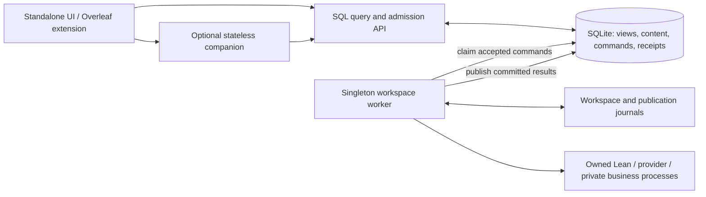

# Stage 8 — separate API and workspace worker

Implemented 2026-10-17. This record supersedes the historical web-process runtime
and Git-only content descriptions. The governing contract remains
[FEATURE-database-mediated-lea.md](FEATURE-database-mediated-lea.md).

## Runtime and authority



`run_api.py` serves HTTP, SSE, static assets and infrastructure credential intake.
It starts no workers, performs no recovery or migrations, acquires no worker lock,
and does not import the prover. Application queries, downloads, saved source,
editor results and admission decisions use SQL. Its shutdown only closes HTTP
connections. Observer disconnection does not stop accepted work.

`run_worker.py` owns the physical workspace, command consumers, run scheduler,
publication recovery, dependency services, catalogs, provider calls and compiler
children. `app/worker.py` contains the former web startup/recovery sequence. The
private Node business process remains a child of this worker. Its authenticated
HTTP calls access the same SQL query/admission service, with a recorded parent
command and database-verified epoch proof. They cannot invoke execution in the API
or send navigation/selection instructions to a client.

Public routes live in `app/api_routes/`. They contain SQL queries, typed request
contracts and queue intake. Execution handlers remain private in `app/routes/`,
registered only in the worker. Contract tests compare the route set and request
schemas. `workspace_commands._contracts` contains public validation contracts;
`_actions` contains executors and must be empty in an API process. Shared SQL
policy, project identity, checkpoints, reports and reformalization admission no
longer import their execution services. Continuation admission retains SQL inputs;
the worker repeats workspace freshness checks before dispatch.

The old in-memory session notification counter is replaced by the durable change
watermark. `RunBroker` is a worker-local SQL publisher/test sink, inaccessible to
the API. Public observation reads the durable cursor directly. There is no legacy
web dispatcher, API-to-bridge signal, source callback or direct LSP fallback.
Admission-disable switches remain emergency stops; none enables a bypass.

## Ownership, fencing and health

Bootstrap and worker retain `.lea-adapter.lock` beside the DB, including its old
name so an earlier live owner prevents a transition. Alembic separately serializes
migration planning and backups using its migration lock. The API takes neither
lock. The worker additionally holds `.lea-worker.lock` in the resolved physical
workspace for local development. Containers use the shared Docker local
`lea-workspace-ownership` volume at `.lea-runtime` instead of their private image
root. Both migration and worker take that ownership lock. Startup verifies that
the filesystem enforces exclusive locks; virtualized bind mounts that silently
ignore them are rejected. A version-2 `.lea-workspace.json` binding beside the DB
pins the root and persistent ownership-volume identity. Root/volume relocation
requires an offline migration. See the [production ownership contract](STAGE8-release-qualification.md).

Before recording a new lifetime or recovering journals, the worker verifies and
reaps the old data-directory child manifests and the new workspace-owned manifests.
A child must still hold its inherited ownership lease before its process group
can be signalled. Unverifiable ownership fails closed, including a held lease left
between child spawn and receipt registration. SQL lease expiry never
permits overlap with a live workspace owner. Locks remain held until process
exit/exec, including while daemon threads finish.

Migration `0048_process_boundary` adds the singleton worker publication: runtime
identity, monotonically increasing generation, PID, lifecycle state, timestamps,
non-secret capabilities, operational snapshot and hashed private bridge proof.
The worker publishes each second with a 15-second observation lifetime. The API
never probes its PID, workspace or compiler. Expiry reports `worker_unavailable`;
a mismatched advertised boundary reports `worker_incompatible` and closes new
execution admission. Control intents retain their independent queue lane.

`/api/health` reports HTTP availability plus SQL worker state. `/api/ready` returns
503 until the worker is ready. During recovery, drain or an expired heartbeat,
ordinary database views remain available. Restart/shutdown requests are queued
worker controls; they do not restart or terminate the API. A control records its
target runtime identity; replay cannot restart a replacement lifetime. The
supervisor restarts a crashed role independently; a clean stop or repeated crash
loop leaves the other roles running. Pending commands and idempotent receipts
survive both processes. Workers reject an unsupported queued command version
before execution.

## Enforced API boundary

Every API entry installs `api_boundary.py` before loading routes. It rejects
preloaded/private execution modules, prover/provider imports, executor/observer
registration, workspace/config reads, child processes, outgoing connections and
DNS resolution. Allowed filesystem access is the database/journal directory,
explicit HTTP/credential intake scratch, static assets, code/runtime libraries and
system MIME data. It removes inherited provider credentials. API tests run this
boundary in fresh processes, rather than treating embedded test seams as isolation.

The local audit guard prevents accidental architectural violations; it is not a
sandbox against injected malicious Python. Container isolation adds a read-only
API filesystem with the workspace, compiler, configuration and worker Node trees
absent. Compose mounts only the DB directory into the API, drops capabilities and
uses `no-new-privileges`. Only the worker and the privileged one-shot migration job
mount config, proofs, project metadata, legacy import input and the Mathlib build
volume, plus their shared ownership volume. Bootstrap can
therefore recover historical Git-backed content before either serving process
starts; the HTTP API never receives these mounts. The transport has no state or
workspace mount. Credential tickets remain the explicitly allowed infrastructure
exception, never command payloads or SQL secret blobs.

Standalone startup and the stateless companion negotiate boundary v1, including
query, change, command, source-publication and queued-editor versions. Missing or
incompatible services are rejected; they cannot activate an older transport.
Worker contracts are checked separately from HTTP availability. Legacy endpoints
remain typed SQL translators or explicit rejections, inventoried by the boundary
audit. Reads never trigger scans or recovery.

## Launch and upgrade

Local `npm run start:adapter`, `npm run dev -w apps/lea-standalone` and the shared
supervisor first run `adapter/bootstrap.py`, then independently supervise API and
worker. `LEA_CONFIG_FILE` selects a worker infrastructure config;
`LEA_SHARED_DATA_DIR` selects shared storage. `LEA_DATABASE_FILE` can explicitly
select a database filename. Custom denied paths can be supplied with
`LEA_API_DENY_PATHS`. API and worker must use the same prepared database.

For manual development, after stopping existing owners:

```sh
cd apps/lea-standalone/adapter
.venv/bin/python bootstrap.py
# In separate terminals, with the same data-directory configuration:
.venv/bin/python run_worker.py
.venv/bin/python run_api.py
```

Neither serving entrypoint migrates. An unprepared/incompatible schema refuses
startup. Bootstrap preserves existing data/backups and refuses to migrate beneath
a live workspace worker. Do not migrate while an old API is serving requests.

Compose has four services: a one-shot migration job, API (`lea`), worker, and
optional stateless companion. The Dockerfile provides `api`, `worker` and
`companion` targets. The explicitly dispatched publication workflow qualifies each
role on both native architectures and pushes the saved, tested binaries without
rebuilding. Matching role images must be published before using
the hosted Stage 8 Compose configuration. No image was pushed by this migration.
Pin a matching immutable bundle when qualifying a release.

Keep all existing host directories and named volumes. Stop the old stack, retain
its backup, run migration, then start the matching pair/transport. Never use
`down -v`, reset-local-state, or volume recreation as an upgrade mechanism.

## Qualification and release limits

Development-cutover results are in
[stage8-qualification.json](database-migration-baselines/stage8-qualification.json)
and [stage8-container.json](database-migration-baselines/stage8-container.json).
The tests cover API denial/import isolation, public route/schema parity, duplicate
owners across one/two DBs, migration ownership, owned-child reaping before takeover,
API restart during an active scripted run, lost acknowledgements, worker crash,
old claim fencing, recovery classification, worker control/re-exec and SQL read
availability. Browser coverage includes real Monaco, selection preservation,
settings, proof freshness and approval behavior.

Final checks include 17 native lifetime/fencing cases, 55 checkpoint cases,
42 Linux ARM64 lifecycle/recovery cases, 942 JavaScript cases, 14 cross-layer
integration cases and all 13 distinct browser cases. The broader adapter gate
completed through sequential file-range reruns after each repair; its final range
passed 592 cases. Counts overlap with targeted suites. The JSON records the
ranges and repairs rather than representing them as one uninterrupted full run.
Type checking, the frontend build, the boundary audit and Compose validation pass.

[The native editor probe](database-migration-baselines/stage8-editor-macos-arm64.json)
starts the canonical API and worker in separate processes. Real HTTP requests
publish a buffer, queue diagnostics/goals/hover/completion/term goals, and read SQL
results from confined Lean 4.29.0. Initial analysis took 1,216 ms; the subsequent
four requests took 370–725 ms each. The source file remained unchanged, no proof
evidence was created, and the result remained readable after worker shutdown.
These five small-file requests qualify the transport and ownership path, not a
production latency distribution. Reproduce with `LEA_TEST_NATIVE_EDITOR=1` and
`pytest tests/test_process_boundary.py::test_native_editor_through_separate_api_and_worker`
from the adapter directory; `LEA_STAGE8_EDITOR_REPORT` selects a report path.

The historical Linux container probe uses a copied-current-code API image built from the
cached qualification runtime, with the workspace physically removed and a separate
DB mount. It validates a read-only API, independent restarts and receipt reuse.
It is not a complete production Dockerfile build or a published multi-architecture
release qualification. The subsequent [production release gate](STAGE8-release-qualification.md)
builds the full Dockerfile, measures native runtime architectures, and retains
both qualified strict bundles for an actual binary rollback rehearsal.
Linux native proof execution remains unavailable where the
confined executor is unsupported; this stage adds no unconfined fallback. Native
proof/repair qualification is performed on supported macOS.

Rollback is restricted to a previously qualified, schema/journal-compatible strict
API/worker/client bundle. Drain active work, inspect/suspend uncertain claims,
reconcile publication journals, stop both processes, then switch the matching
binaries and start one worker. Recheck retained receipts and resource ownership.
Never downgrade schema or remove history. Stages 0–7 are not compliant rollback
targets. The production release gate first qualifies and retains a strict baseline,
then qualifies a distinct successor and rehearses rollback on the same database
and workspace. Its exact source, image and archive pins govern that rollback;
the development restart tests alone do not certify a prior binary bundle.
An executable-AST comparison also qualifies the exact documentation-only LSP
daemon checkpoint hash change; the predecessor/destination pins remain exact
and all existing settled-state checks still apply. See
[stage8-checkpoint-review.json](database-migration-baselines/stage8-checkpoint-review.json).
The earlier development tests qualify compatible restart/recovery and rejection
of incompatible contracts. Full production and binary rollback evidence is
recorded separately in the release guide.
